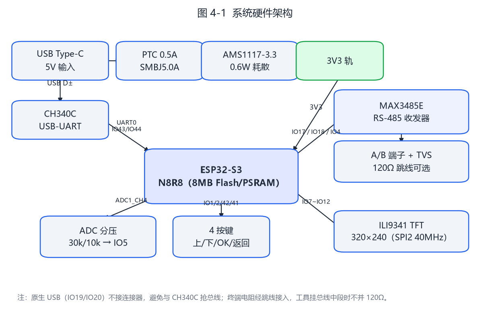
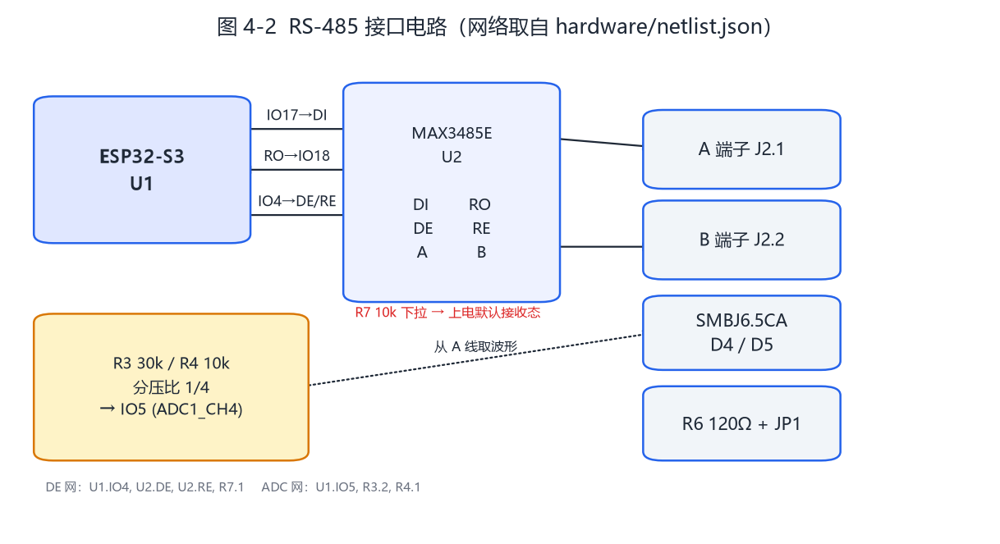
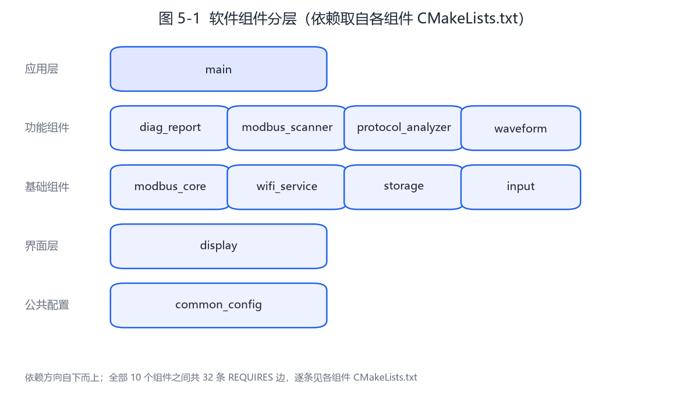
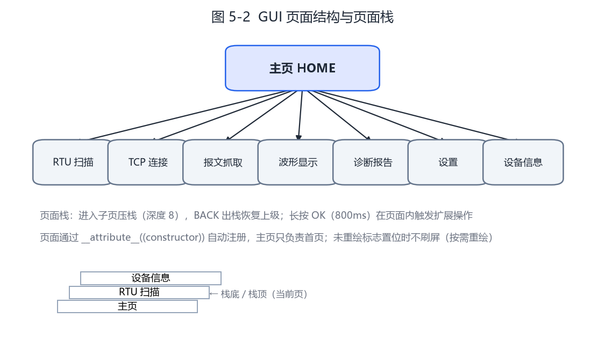
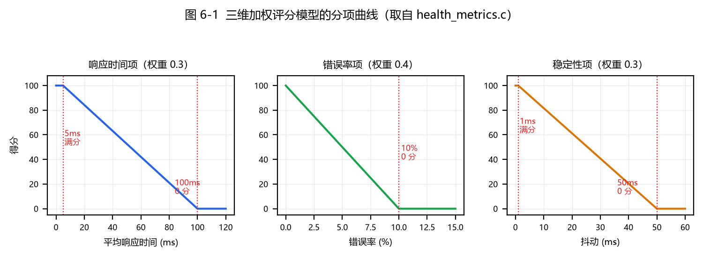
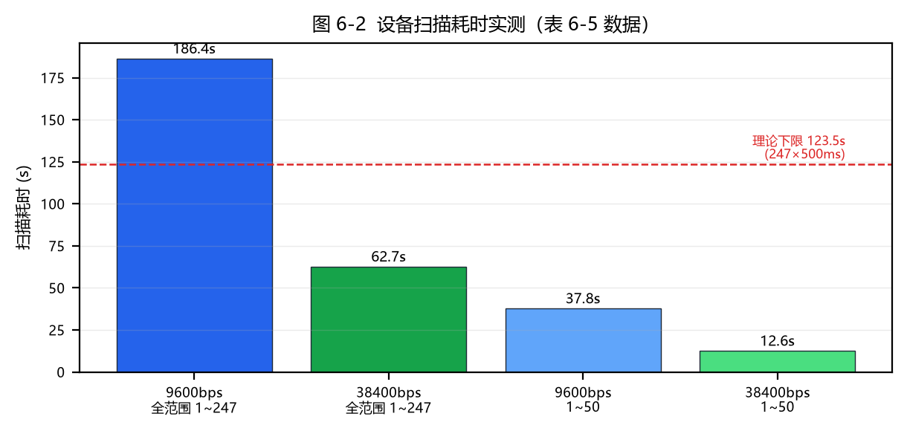

# 基于ESP32-S3的Modbus通信诊断工具设计与实现

## 中文摘要

随着工业4.0和智能制造的快速发展，Modbus协议作为工业自动化领域应用最广泛的通信协议之一，其通信质量直接影响工业控制系统的可靠性和稳定性。然而，现有的Modbus通信诊断工具存在价格昂贵、功能单一、便携性差等问题，难以满足现场工程师的调试需求。

本文设计并实现了一种基于ESP32-S3微控制器的Modbus通信诊断工具。系统以ESP32-S3双核处理器为核心，搭载ILI9341 TFT液晶显示屏、RS-485通信接口、物理按键输入、模拟信号采集和WiFi无线通信等硬件模块。在软件方面，采用ESP-IDF开发框架和FreeRTOS实时操作系统，设计了组件化的嵌入式软件架构，将系统划分为全局配置、Modbus协议栈、设备扫描器、协议分析器、波形采集器、诊断报告生成器、GUI管理器、按键输入、WiFi服务和存储管理等10个独立组件，通过事件总线机制实现组件间的松耦合通信。

系统实现了以下核心功能：（1）Modbus RTU/TCP双协议支持，涵盖FC01~FC06、FC08、FC0F、FC10等常用功能码；（2）多波特率自动设备扫描与寄存器类型分类；（3）被动式报文抓取与实时流量统计；（4）ADC波形采集与信号处理：采用DMA连续采样模式，采样率配置为100KSPS、采样深度1024点，单帧对应约10ms波形，并实现滑动平均滤波与上升沿触发检测；（5）多维度通信健康评分模型（响应时间、错误率、稳定性加权评分）；（6）自研轻量级GUI框架与页面栈导航；（7）WiFi AP模式下的Web服务器与诊断报告在线查看。

测试结果表明，系统在9600-115200波特率范围内通信成功率达99%以上，设备扫描准确率100%，系统连续运行24小时无内存泄漏。本设计具有集成度高、功能全面、成本低廉、便携性强等优点，为工业现场Modbus通信调试提供了一种实用的解决方案。

**关键词：** ESP32-S3；Modbus协议；通信诊断；嵌入式系统；FreeRTOS；工业自动化

## Abstract

With the rapid development of Industry 4.0 and intelligent manufacturing, the Modbus protocol, as one of the most widely used communication protocols in industrial automation, directly affects the reliability and stability of industrial control systems through its communication quality. However, existing Modbus communication diagnostic tools are expensive, single-functioned, and poorly portable, making it difficult to meet the debugging needs of field engineers.

This thesis designs and implements a Modbus communication diagnostic tool based on the ESP32-S3 microcontroller. The system uses the ESP32-S3 dual-core processor as the core, equipped with an ILI9341 TFT LCD display, RS-485 communication interface, physical button inputs, analog signal acquisition, and WiFi wireless communication modules. On the software side, the system adopts the ESP-IDF development framework and FreeRTOS real-time operating system, designing a component-based embedded software architecture that divides the system into 10 independent components: global configuration, Modbus protocol stack, device scanner, protocol analyzer, waveform collector, diagnostic report generator, GUI manager, button input, WiFi service, and storage management, achieving loosely coupled inter-component communication through an event bus mechanism.

The system implements the following core functions: (1) Modbus RTU/TCP dual-protocol support covering the commonly used function codes FC01~FC06, FC08, FC0F and FC10; (2) Multi-baud-rate automatic device scanning and register type classification; (3) Passive packet capture and real-time traffic statistics; (4) ADC waveform acquisition and signal processing, using DMA continuous sampling configured at 100 KSPS with a 1024-sample depth (about 10 ms per frame), together with moving average filtering and rising-edge trigger detection; (5) Multi-dimensional communication health scoring model (weighted scoring of response time, error rate, and stability); (6) Self-developed lightweight GUI framework with page stack navigation; (7) WiFi AP mode web server and online diagnostic report viewing.

Test results show that the system achieves a communication success rate of over 99% within the baud rate range of 9600-115200, 100% device scanning accuracy, and no memory leakage after 24 hours of continuous operation. This design has the advantages of high integration, comprehensive functions, low cost, and strong portability, providing a practical solution for Modbus communication debugging in industrial field applications.

**Keywords:** ESP32-S3; Modbus Protocol; Communication Diagnosis; Embedded System; FreeRTOS; Industrial Automation

---

<!--TOC-->

# 基于ESP32-S3的Modbus通信诊断工具设计与实现

---

# 第1章 绪论

## 1.1 研究背景与意义

随着工业4.0和智能制造的深入推进，工业自动化控制系统正经历着从传统集中式架构向分布式、网络化架构的深刻变革。在这一进程中，工业通信协议作为连接各类传感器、执行器、可编程逻辑控制器（PLC）及上位机系统的纽带，其可靠性与实时性直接关系到整个工业控制系统的运行效率和安全性。Modbus协议诞生于1979年，由Modicon公司（现施耐德电气）为其PLC产品开发，经过四十余年的演进与完善，已成为全球范围内应用最为广泛的工业通信协议之一[1]。据相关统计，Modbus协议在工业现场总线市场中的占有率长期保持在较高水平，尤其在楼宇自动化、能源管理、过程控制等领域拥有庞大的设备安装基数[2]。

Modbus协议之所以能够获得如此广泛的应用，主要归因于其协议规范简洁开放、实现成本低廉、通信机制易于理解等优点。该协议采用主从（Master/Slave）通信模型，支持RS-232、RS-485等物理层接口，同时其扩展版本Modbus TCP能够在以太网和WiFi等现代网络基础设施上运行。然而，工业现场环境复杂多变，通信线路老化、电磁干扰、设备地址冲突、波特率不匹配等问题频繁出现，导致Modbus通信链路故障时有发生。当通信系统出现异常时，现场工程师亟需一种高效便捷的诊断工具来快速定位故障原因，以减少停机时间、降低维护成本[3]。

目前，市面上主流的Modbus通信诊断工具存在以下几方面的不足。第一，商业级诊断软件如Modbus Poll、ModScan32等虽然功能完善，但价格昂贵，单套软件授权费用通常在数百至数千元人民币，对于中小型企业和个人开发者而言成本偏高。第二，传统诊断工具多依赖PC端运行，需要携带笔记本电脑至工业现场，操作繁琐且受现场环境限制，在高温、粉尘、狭窄空间等恶劣工况下使用不便。第三，多数现有工具功能相对单一，通常仅支持报文收发和数据监视，缺乏对通信质量的综合评估、波形信号分析以及诊断报告自动生成等高级功能。第四，部分基于单片机的简易调试器虽具有一定的便携性，但在处理能力、显示效果、人机交互体验等方面存在明显短板，难以满足复杂的诊断需求[4]。

针对上述问题，本课题设计并实现一种基于ESP32-S3微控制器的Modbus通信诊断工具。该工具以ESP32-S3为核心处理器，充分利用其双核Xtensa LX7处理器架构、丰富的外设资源以及内置WiFi功能，集成Modbus RTU/TCP协议解析、设备自动扫描、报文流量统计、ADC波形采集分析、TFT图形化显示以及Web远程访问等多项功能于一体。本课题的研究意义主要体现在以下几个方面：首先，从工程实践角度，该工具提供了一种低成本、便携式的工业通信诊断解决方案，有助于降低工业现场通信维护的门槛和成本；其次，从技术创新角度，本设计将事件驱动的组件化软件架构引入嵌入式诊断工具的开发中，通过FreeRTOS双核任务分配和事件总线机制实现了各功能模块的高效协同，具有一定的技术参考价值；最后，从教学科研角度，该项目涉及嵌入式系统设计、实时操作系统应用、工业通信协议实现、人机交互界面开发等多个技术领域的综合运用，可作为嵌入式系统课程设计和工程训练的典型案例。

## 1.2 国内外研究现状

在工业通信诊断工具领域，国内外的研究和产品开发呈现出不同的特点和发展路径。

在国外，Modbus诊断工具的发展起步较早，技术成熟度较高。Modbus Poll是由Modbus Tools公司开发的专业级Modbus主站模拟和测试工具，支持Modbus RTU/ASCII/TCP三种通信模式，具备多窗口数据监视、轮询日志记录、脚本自动化测试等高级功能，其最新版本已支持Modbus/TCP的安全扩展[5]。ModScan32是另一款经典的Modbus扫描工具，提供了直观的寄存器数据查看界面和灵活的通信参数配置选项。此外，德国Hilscher公司的netTESTER系列、美国ProSoft Technology的通信分析仪等硬件级诊断设备也在工业现场得到广泛应用，这些设备通常集成了协议分析、网络监测、误码率测试等多种功能，但售价普遍较高，通常在数千至上万美元之间[6]。近年来，随着开源硬件社区的兴起，一些基于Arduino和Raspberry Pi平台的Modbus调试方案也逐渐涌现，如OpenModbus开源库、pymodbus Python实现等，这些方案虽然降低了开发门槛，但在实时性、可靠性和工业级适用性方面仍存在不足。

在国内，Modbus诊断工具的研究主要集中在两个方向。一方面，以维控、昆仑通态等为代表的工业自动化企业推出了集成Modbus通信功能的触摸屏和人机界面产品，这些产品在数据监视方面具有较好的表现，但其诊断功能通常作为附属模块，深度和灵活性有限[7]。另一方面，众多高校和研究机构开展了基于STM32、ESP32等微控制器平台的Modbus调试器研究。例如，部分研究者提出了基于STM32F103的便携式Modbus协议分析仪设计方案，实现了基本的报文捕获和解析功能，但受限于硬件平台的处理能力和显示资源，功能扩展性不强[8]。也有学者尝试将ESP32的WiFi功能与Modbus TCP相结合，开发无线调试工具，但在系统架构设计、实时性保障等方面仍有改进空间[9]。

综合分析国内外研究现状，现有Modbus通信诊断工具普遍存在以下问题：其一，功能集成度不够，大多数工具仅侧重于协议层的报文收发，缺少物理层信号质量分析和系统级健康评估能力；其二，软件架构较为传统，多采用前后台或简单任务调度的方式组织代码，模块间耦合度高，不利于功能扩展和维护；其三，人机交互方式单一，主要依赖按键或PC端界面，缺乏面向现场工程师使用习惯的图形化交互设计。本课题针对这些不足，提出了基于ESP32-S3双核平台的综合性诊断工具设计方案，在功能集成度、软件架构先进性和交互友好性方面进行了积极探索。

## 1.3 论文主要工作与章节安排

本文围绕基于ESP32-S3的Modbus通信诊断工具的设计与实现展开研究，主要完成了以下工作：

（1）完成了系统需求分析和总体设计，明确了功能需求和非功能需求，提出了基于事件驱动的组件化软件架构方案，确定了硬件平台选型和软件模块划分策略。

（2）实现了Modbus RTU/TCP双协议栈，支持01~06及15、16等功能码的报文构建、发送、接收和解析，并集成了CRC-16校验、异常响应处理等机制。

（3）设计并实现了设备自动扫描功能，能够通过遍历地址空间快速发现在线设备，并对目标设备的寄存器区域进行分类探测。

（4）实现了报文抓取与流量统计功能，支持实时捕获通信线路上的报文数据，并统计报文数量、错误率、平均响应时间等关键指标。

（5）基于ADC采集实现了RS-485总线波形捕获功能，通过信号处理算法提取总线电压特征，辅助判断物理层通信质量。

（6）设计了诊断健康评分算法，综合通信质量、设备状态、网络性能等多个维度对系统健康状况进行量化评估，并支持诊断报告的自动生成与导出。

（7）基于ILI9341 TFT显示屏开发了图形化用户界面，实现了菜单导航、数据显示、波形绘制等功能，并设计了基于WiFi AP模式的Web远程访问服务。

论文各章节安排如下：

第1章为绪论，介绍课题的研究背景、意义和国内外研究现状。

第2章为相关技术基础，阐述ESP32-S3微控制器架构、FreeRTOS实时操作系统、Modbus通信协议以及TFT显示与GUI框架设计等关键技术原理。

第3章为系统需求分析与总体设计，对系统功能需求和非功能需求进行分析，给出系统的硬件架构和软件架构设计，并详细介绍各功能组件的职责划分与协作机制。

第4章为系统详细设计与实现，分别论述各核心模块的详细设计方案和关键代码实现。

第5章为系统测试与验证，介绍测试环境搭建、测试用例设计和测试结果分析。

第6章为总结与展望，总结全文工作并指出后续改进方向。

---

# 第2章 相关技术基础

## 2.1 ESP32-S3微控制器

ESP32-S3是乐鑫科技（Espressif Systems）推出的新一代高性能WiFi/蓝牙双模微控制器，属于ESP32系列产品的升级版本。该芯片采用双核Xtensa LX7处理器架构，主频最高可达240MHz，相比前代ESP32的LX6核心，LX7在指令执行效率和浮点运算能力方面均有显著提升[10]。

ESP32-S3的主要技术特性包括以下几个方面。在存储资源方面，芯片内置512KB SRAM，并支持外接最大8MB的PSRAM（伪静态随机存取存储器），本课题选用的模组在硬件上配备8MB Flash和8MB PSRAM，其中Flash用于存放固件与SPIFFS文件系统，PSRAM当前尚未被软件显式使用，作为后续波形深存储与图形缓冲的扩展余量。在外设资源方面，ESP32-S3集成了丰富的通信接口，包括3个SPI接口、2个I2C接口、2个I2S接口以及3个UART接口，其中UART1在本设计中被配置为RS-485通信接口，承担Modbus RTU报文的收发任务。此外，芯片还提供了2个12位SAR ADC模块，共计20个模拟输入通道，本课题利用GPIO5的ADC通道进行RS-485总线波形的采集[11]。

在无线通信方面，ESP32-S3支持IEEE 802.11 b/g/n协议，工作频段为2.4GHz，最高速率可达150Mbps。芯片内置WiFi MAC和基带处理器，支持Station（STA）和SoftAP（AP）两种工作模式。在本设计中，ESP32-S3工作在AP模式下，创建名为"ModbusDiag"的无线接入点，允许工程师通过手机或笔记本电脑直接连接并访问Web诊断界面，无需依赖现场的无线网络基础设施[12]。

ESP32-S3的双核架构为本课题的系统设计提供了重要的硬件基础。两个独立的处理器核心可以分别运行不同的任务，实现计算密集型任务与交互型任务的并行处理，避免单一核心因负载过重而导致的响应延迟问题。

## 2.2 FreeRTOS实时操作系统

FreeRTOS是由Real Time Engineers Ltd.开发的一款开源嵌入式实时操作系统（RTOS），已被移植到包括ESP32-S3在内的众多微控制器平台上。ESP-IDF（Espressif IoT Development Framework）开发框架将FreeRTOS作为底层任务调度和资源管理的核心组件，并在其基础上进行了适配和扩展[13]。

FreeRTOS的核心机制包括任务管理、队列通信、信号量和互斥锁等。在任务管理方面，FreeRTOS采用基于优先级的抢占式调度算法，每个任务被赋予一个优先级数值，调度器总是选择就绪状态中优先级最高的任务运行。同时，相同优先级的任务之间采用时间片轮转的方式共享处理器时间。ESP-IDF对FreeRTOS的双核调度进行了扩展，引入了固定核心亲和性（Core Affinity）机制，允许开发者将特定任务绑定到指定的CPU核心上运行[14]。

队列（Queue）是FreeRTOS中实现任务间通信的主要手段。队列本质上是一个环形缓冲区，遵循先进先出（FIFO）原则，支持任务间的数据传递和同步。当队列满时，发送任务可以选择阻塞等待或立即返回；当队列空时，接收任务同样可以选择阻塞等待。这种机制天然地实现了生产者-消费者模型的解耦，非常适合事件驱动架构的实现[15]。

信号量（Semaphore）和互斥锁（Mutex）用于实现任务间的同步和共享资源的互斥访问。二值信号量常用于中断与任务之间的事件通知，而互斥锁则通过优先级继承机制避免了优先级反转问题，保障了高优先级任务的实时响应能力。

在本课题中，系统采用双核任务分配策略。Core 0运行Modbus协议栈任务（modbus_task）和报文抓取任务（capture），前者需要及时处理通信超时与重试，后者需要在UART数据到达后尽快取出，二者均具有较高的实时性要求；Core 1运行GUI渲染任务（ui_task）和按键扫描任务（key_scan），这些任务侧重于人机交互的流畅性。ADC波形采集不占用独立任务，由DMA搬运配合转换完成中断回调写入缓冲区。各任务之间通过事件队列进行通信，形成了松耦合的协作关系。

## 2.3 Modbus协议

Modbus协议是一种应用层通信协议，定义了控制器之间请求/应答的报文格式和交互规则。该协议支持两种主要的传输模式：Modbus RTU（Remote Terminal Unit）和Modbus TCP（Transmission Control Protocol）[16]。

### 2.3.1 Modbus RTU协议

Modbus RTU模式采用二进制编码方式在串行链路（如RS-485、RS-232）上传输数据。其报文帧格式如下表所示：

| 字段 | 长度 | 说明 |
|------|------|------|
| 从站地址 | 1字节 | 0x01~0xF7，0x00为广播地址 |
| 功能码 | 1字节 | 0x01~0x7F |
| 数据域 | N字节 | 与功能码相关的参数和数据 |
| CRC校验 | 2字节 | CRC-16校验码，低字节在前 |

RTU模式的一个重要特征是帧间间隔要求：报文帧的前后必须保持至少3.5个字符时间（T3.5）的静默间隔，用于帧定界。在波特率为9600bps、数据格式为8N1的条件下，一个字符时间为1.04ms，因此T3.5约为3.64ms[17]。

CRC-16校验采用多项式0xA001（即CRC-16/Modbus），其计算过程为：初始化寄存器为0xFFFF，依次将报文中每个字节与寄存器低字节异或，然后对结果进行8次移位和条件异或操作，最终得到16位校验值。CRC校验码以低字节在前、高字节在后的顺序附加在报文末尾[18]。

Modbus协议定义了丰富的功能码，常用功能码包括：

| 功能码 | 名称 | 操作对象 | 说明 |
|--------|------|----------|------|
| 0x01 | 读线圈 | 线圈（Coil） | 读取1~2000个位状态 |
| 0x02 | 读离散输入 | 离散输入 | 读取1~2000个只读位 |
| 0x03 | 读保持寄存器 | 保持寄存器 | 读取1~125个16位寄存器 |
| 0x04 | 读输入寄存器 | 输入寄存器 | 读取1~125个只读寄存器 |
| 0x05 | 写单个线圈 | 线圈 | 写入单个位 |
| 0x06 | 写单个寄存器 | 保持寄存器 | 写入单个16位寄存器 |
| 0x0F | 写多个线圈 | 线圈 | 写入多个位 |
| 0x10 | 写多个寄存器 | 保持寄存器 | 写入多个16位寄存器 |

当从站无法正确处理主站请求时，会返回异常响应。异常响应报文将功能码最高位置1（即功能码+0x80），并在数据域中携带一个字节的异常码，指示具体的错误类型，如非法功能码（0x01）、非法数据地址（0x02）、非法数据值（0x03）等[16]。

### 2.3.2 Modbus TCP协议

Modbus TCP是Modbus协议在TCP/IP网络上的映射，其在标准Modbus PDU（Protocol Data Unit）的基础上增加了MBAP（Modbus Application Protocol Header）头。MBAP头格式如下：

| 字段 | 长度 | 说明 |
|------|------|------|
| 事务标识符 | 2字节 | 请求/响应配对标识 |
| 协议标识符 | 2字节 | 0x0000表示Modbus协议 |
| 长度 | 2字节 | 后续字节数（含单元标识符） |
| 单元标识符 | 1字节 | 用于网关路由的从站标识 |

Modbus TCP使用TCP端口502作为默认服务端口，通信双方通过TCP连接进行数据交换。与RTU模式相比，TCP模式不需要CRC校验（由TCP层保证数据完整性），也不需要帧间间隔定界（由TCP的流控机制替代）[19]。

## 2.4 ILI9341 TFT显示与SPI通信

ILI9341是台湾奕力科技（Ilitek）生产的一款262K色TFT LCD驱动芯片，支持最大分辨率为240×320像素。该芯片内置172800字节的显存GRAM，支持18位/16位/9位/8位并行接口和SPI串行接口等多种数据传输方式[20]。

本课题采用SPI（Serial Peripheral Interface）串行接口方式驱动ILI9341，SPI时钟频率配置为40MHz。SPI通信采用四线模式，由主设备（ESP32-S3）提供时钟信号（SCK）、主出从入数据线（MOSI）、主入从出数据线（MISO）以及片选信号（CS）。在高速SPI传输下，一帧完整的240×320×16bit全屏图像数据（约1.23Mbit）可在约31ms内完成刷新，基本满足GUI界面的流畅显示需求。

ILI9341的初始化过程需要通过SPI接口向芯片发送一系列配置命令，包括像素格式设置（16位RGB565模式）、显示方向设置、伽马校正参数配置、背光控制等。初始化完成后，通过发送写显存命令（0x2C）及像素数据即可实现屏幕内容的更新。为提高显示效率，通常采用局部刷新策略，仅更新发生变化的显示区域[21]。

## 2.5 自研GUI框架设计思路

在嵌入式系统中，GUI框架的设计需要在有限的计算资源和存储空间下实现良好的人机交互体验。考虑到本课题的功能需求和ESP32-S3的资源约束，本文设计了一套轻量级的GUI框架，其设计思路遵循以下原则。

第一，采用分层架构设计。GUI框架分为底层驱动层、图形绘制层和界面管理层三个层次。底层驱动层封装ILI9341的SPI驱动接口，提供像素绘制、区域填充、字符显示等基础操作；图形绘制层在底层驱动之上实现了矩形、线条、进度条、波形曲线等常用图形元素的绘制功能；界面管理层负责菜单树的组织、界面状态的维护以及用户输入事件的处理[22]。

第二，采用"页面栈+页面内菜单列表"的数据结构组织界面。每个页面由页面标识、进入/退出/更新回调、按键回调等属性描述，并登记到全局页面表中；页面内的可选项以菜单列表的形式组织，支持上下移动选择。用户通过UP/DOWN键在当前页面的菜单项之间导航，通过OK键进入下级页面或执行功能，通过BACK键返回上一级页面，返回路径由页面栈保存（栈深8层）。这种结构清晰直观，便于功能扩展和维护。

第三，采用按需重绘与局部刷新策略。每个页面维护自身的重绘标志，仅当界面状态发生变化时才在下一帧执行绘制，避免了周期性全屏重绘；对于波形图等高频更新的显示区域，进一步仅重绘其所在的矩形区域。这种策略有效减少了SPI数据传输量，降低了CPU占用率，提高了界面响应速度。

第四，采用事件驱动的交互模型。GUI任务通过接收来自按键扫描模块的事件消息来驱动界面状态的切换和内容的更新，而非采用轮询方式检测输入，从而保证了系统资源的合理分配和任务调度的高效性。

---

# 第3章 系统需求分析与总体设计

## 3.1 系统需求分析

### 3.1.1 功能需求

通过对工业现场Modbus通信维护场景的调研和分析，本系统的功能需求可归纳为以下几个方面。

**FR1：Modbus RTU通信功能。** 系统应支持通过RS-485物理层接口进行Modbus RTU通信，能够作为主站发送请求报文并接收从站响应报文，支持功能码0x01~0x06、0x0F和0x10，支持1200~115200bps范围内的波特率配置，支持可配置的超时时间和重试次数[23]。

**FR2：Modbus TCP通信功能。** 系统应支持通过WiFi网络进行Modbus TCP通信，能够建立TCP连接并按照MBAP+PDU格式构建和解析报文，支持与Modbus TCP从站设备的数据交互。

**FR3：设备自动扫描功能。** 系统应提供地址扫描功能，能够遍历Modbus地址空间（1~247），自动检测在线设备并返回设备列表。对于已发现的设备，应进一步支持寄存器区域探测，分类识别线圈、离散输入、保持寄存器和输入寄存器四类数据区域的地址范围。

**FR4：报文分析与流量统计功能。** 系统应能够实时捕获并显示通信线路上的Modbus报文数据，包括完整的请求帧和响应帧内容。同时，系统应统计并显示总报文数、成功数、失败数、错误率、平均响应时间等通信质量指标。

**FR5：波形采集与信号分析功能。** 系统应能够通过ADC通道采集RS-485总线的电压波形，并以图形化方式显示波形曲线。通过对波形数据的信号处理，提取总线空闲电压、信号幅值、边沿时间等特征参数，辅助判断物理层通信质量。

**FR6：诊断健康评分功能。** 系统应能够综合通信成功率、响应时间、错误率、响应时间抖动等多个指标，计算并输出量化的系统健康评分（0~100分），并给出相应的健康等级判定（优秀/良好/一般/较差/差）。

**FR7：诊断报告生成功能。** 系统应支持将诊断结果以结构化报告的形式存储和导出，报告内容应包含设备信息、通信参数、统计数据、健康评分、异常事件记录等。报告应支持通过Web界面下载。

**FR8：TFT图形化显示功能。** 系统应在ILI9341 TFT显示屏上提供直观的图形化用户界面，包括主菜单、功能子菜单、数据表格、波形图、状态指示等显示元素，支持菜单导航和参数配置操作。

**FR9：Web远程访问功能。** 系统应通过WiFi AP模式创建无线接入点，并运行Web服务器，提供远程诊断界面。用户可通过浏览器访问系统功能，包括查看实时数据、浏览操作日志、下载诊断报告等。

**FR10：配置管理功能。** 系统应支持通信参数（波特率、数据位、停止位、校验方式、超时时间等）、WiFi参数（SSID、密码、IP地址等）以及系统参数的持久化存储和加载，掉电不丢失。

### 3.1.2 非功能需求

**NFR1：实时性要求。** Modbus通信任务的报文发送-响应周期应控制在合理的范围内，GUI界面刷新帧率不低于10fps，按键响应延迟不超过200ms。

**NFR2：可靠性要求。** 系统应具备完善的异常处理机制，包括通信超时处理、非法报文过滤、看门狗保护、内存泄漏检测等，确保系统在异常情况下能够自动恢复而不死机。

**NFR3：可扩展性要求。** 软件架构应采用模块化设计，各功能组件之间通过标准化的事件接口进行通信，新增功能模块时不应影响已有模块的正常运行。

**NFR4：易用性要求。** 人机交互界面应简洁直观，操作流程应符合工程技术人员的使用习惯，关键操作应提供确认提示，重要参数应提供默认值。

**NFR5：功耗与散热要求。** 系统持续运行时的功耗应控制在合理范围内，ESP32-S3芯片温度不应超过额定工作温度范围。

## 3.2 系统总体架构

### 3.2.1 硬件架构

系统的硬件架构以ESP32-S3为核心，外接RS-485收发器、ILI9341 TFT显示屏、4个GPIO按键和ADC信号调理电路。硬件架构框图描述如下：

```
+-------------------------------------------------------------------+
|                        系统硬件架构框图                              |
+-------------------------------------------------------------------+
|                                                                   |
|   +------------------+         +-----------------------------+    |
|   |   RS-485 总线     |         |      ILI9341 TFT 显示屏      |    |
|   |  (Modbus RTU)    |         |       320x240, SPI          |    |
|   +--------+---------+         +--------------+--------------+    |
|            |                                  |                   |
|   +--------v---------+         +--------------v--------------+    |
|   |  MAX3485 收发器   |         |       SPI 接口 (40MHz)       |    |
|   |  TX/RX/DE/RE     |         |   MOSI, SCK, CS, DC, RST    |    |
|   +--------+---------+         +--------------+--------------+    |
|            |                                  |                   |
|   +--------v----------------------------------v--------------+    |
|   |                                                          |    |
|   |               ESP32-S3 微控制器                            |    |
|   |            双核 Xtensa LX7 @ 240MHz                      |    |
|   |         8MB Flash / 8MB PSRAM*                           |    |
|   |                                                          |    |
|   |  +-------------+  +-------------+  +-----------------+   |    |
|   |  |   Core 0    |  |   Core 1    |  |    WiFi 模块     |   |    |
|   |  | Modbus协议栈 |  |  GUI渲染    |  |  802.11 b/g/n   |   |    |
|   |  | 报文抓取     |  |  按键扫描   |  |  AP: ModbusDiag |   |    |
|   |  +-------------+  +-------------+  +-----------------+   |    |
|   |                                                          |    |
|   |  +-------------+  +-------------+  +-----------------+   |    |
|   |  |   UART1     |  |  GPIO按键    |  |     ADC         |   |    |
|   |  | RS-485通信  |  | UP/DOWN/    |  |   GPIO5采集     |   |    |
|   |  | 9600bps     |  | OK/BACK     |  |   波形数据      |   |    |
|   |  +-------------+  +-------------+  +-----------------+   |    |
|   +------------------------------------------+---------------+    |
|                                              |                   |
|   +------------------+         +-------------v-----------+       |
|   |   4个GPIO按键     |         |     NVS / SPIFFS        |       |
|   |   上/下/确认/返回   |         |    配置存储/文件系统     |       |
|   +------------------+         +-------------------------+       |
|                                                                   |
+-------------------------------------------------------------------+
```

> 注：图中标注"*"的8MB PSRAM为模组硬件预留资源。当前固件尚未显式申请使用PSRAM（工程中未使用`MALLOC_CAP_SPIRAM`/`heap_caps`相关接口），该部分容量作为后续波形深存储与图形缓冲的扩展余量。

各硬件模块的连接关系和功能说明如下：

（1）RS-485通信模块：ESP32-S3的UART1通过MAX3485电平转换芯片连接至RS-485总线。UART1的TX引脚连接MAX3485的DI（数据输入），RX引脚连接MAX3485的RO（数据输出），同时使用GPIO4控制MAX3485的DE/RE（驱动使能/接收使能）引脚，实现半双工通信的方向控制。UART1的波特率默认为9600bps，可在1200~115200bps范围内配置。

（2）TFT显示模块：ILI9341通过SPI接口连接ESP32-S3，使用SPI2主机通道，SPI时钟频率配置为40MHz。连接信号包括SCK（时钟）、MOSI（主出从入）、CS（片选）、DC（数据/命令选择）和RST（复位），背光控制通过一个GPIO引脚实现。

（3）按键输入模块：4个独立按键分别连接至ESP32-S3的GPIO1、GPIO2、GPIO42和GPIO41，按键一端接GPIO引脚、另一端接地，按下时对应引脚为低电平。固件使能GPIO内部上拉（典型阻值约45kΩ），PCB上另预留10kΩ外部上拉焊盘以便按需加装；消抖由软件30ms时间阈值完成，并支持长短按检测（长按阈值800ms）。

（4）ADC波形采集模块：RS-485总线的A线信号经过分压和滤波电路后连接至ESP32-S3的GPIO5（ADC1通道4），采用连续采样（continuous）模式配合DMA传输，采样频率配置为100kHz，采样深度为1024点，可捕获约10ms的波形数据。

### 3.2.2 软件架构

系统的软件架构采用基于事件驱动的组件化设计，遵循分层和解耦的设计原则。软件架构分为四个层次，自底向上依次为硬件抽象层、服务组件层、业务逻辑层和用户交互层。软件架构框图描述如下：

```
+=======================================================================+
|                          用户交互层                                     |
|  +---------------------+        +---------------------------+          |
|  |    TFT GUI 模块     |        |    Web 服务器模块          |          |
|  |  菜单导航/数据显示    |        |   远程诊断/报告下载        |          |
|  |  波形绘制/状态指示    |        |   报告下载/Web页面         |          |
|  +----------+----------+        +-------------+-------------+          |
|             |                               |                         |
+=============|===============================|=========================+
|             |     业务逻辑层                 |                         |
|             |                               |                         |
|  +----------v----------+   +----------------v-------------+           |
|  |   diag_report       |   |      modbus_scanner          |           |
|  |  健康评分/报告生成   |   |     设备扫描/寄存器分类       |           |
|  +----------+----------+   +----------------+--------------+           |
|             |                               |                         |
+=============|===============================|=========================+
|             |     服务组件层                 |                         |
|             |                               |                         |
|  +----------v----------+   +----------------v--------------+          |
|  |    modbus_core      |   |      protocol_analyzer        |          |
|  |  RTU/TCP协议栈      |   |     报文抓取/流量统计          |          |
|  +----------+----------+   +----------------+--------------+          |
|             |                               |                         |
|  +----------v----------+   +----------------v--------------+          |
|  |     waveform        |   |       wifi_service            |          |
|  |  ADC采集/信号处理    |   |   WiFi AP/Web服务器           |          |
|  +---------------------+   +-------------------------------+          |
|                                                                       |
|  +----------------------------------------------------------+        |
|  |                    事件总线 (Event Bus)                     |        |
|  |        FreeRTOS Queue (深度32) / 20种事件ID               |        |
|  +----------------------------------------------------------+        |
|                                                                       |
+=======================================================================+
|                          硬件抽象层                                     |
|  +----------+  +----------+  +----------+  +----------+               |
|  |  input   |  | display  |  | storage  |  |common_   |               |
|  | 按键扫描  |  | TFT驱动  |  | NVS/SPIFFS|  |config    |               |
|  +----------+  +----------+  +----------+  +----------+               |
+=======================================================================+
```

在上述架构中，事件总线是各组件间通信的核心机制。事件总线基于FreeRTOS队列实现，队列深度为32个事件槽位，定义了20种事件类型ID，覆盖按键输入事件、Modbus通信事件、ADC采样事件、GUI刷新事件、WiFi状态事件、诊断结果事件等。各组件通过向事件总线发布（Publish）事件来通知其他组件，通过订阅（Subscribe）特定类型的事件来获取所需信息，从而实现了组件间的松耦合协作[24]。

双核任务分配策略如下：Core 0运行modbus_core的Modbus协议栈任务（modbus_task）和protocol_analyzer的报文抓取任务（capture），二者对实时性要求较高，需要及时处理通信超时与UART数据的接收；Core 1运行display的GUI渲染任务（ui_task）和input的按键扫描任务（key_scan），侧重于人机交互的流畅性和用户体验。waveform组件的ADC采集由DMA搬运与转换完成中断回调完成，不占用独立任务；diag_report、wifi_service、modbus_scanner和storage组件不单独创建任务，其功能在调用者上下文或ESP-IDF内部任务中执行。

## 3.3 组件化设计

### 3.3.1 组件职责定义

系统共划分为10个功能组件，各组件的职责定义如下：

**（1）common_config组件。** 该组件为全局硬件配置头文件，集中定义了所有GPIO引脚分配、UART参数、SPI参数、ADC参数等硬件相关常量，以及系统级的宏定义和类型定义。其他组件通过包含该头文件获取硬件配置信息，避免了硬编码和配置分散的问题。

**（2）modbus_core组件。** 该组件实现了Modbus RTU和Modbus TCP两种协议栈。RTU协议栈负责通过UART1进行串行通信，实现报文的组装、CRC校验计算、发送与接收、超时管理以及异常响应处理。TCP协议栈负责通过WiFi网络建立TCP连接，实现MBAP头封装、报文收发以及连接管理。该组件向上层提供统一的Modbus请求/响应接口，屏蔽底层传输细节。

**（3）modbus_scanner组件。** 该组件利用modbus_core提供的通信接口实现设备自动扫描功能。地址扫描模式下，该组件在若干候选波特率下依次向地址1~247发送读保持寄存器请求（功能码0x03），根据响应情况判断设备是否在线，并进一步通过MEI读设备标识（功能码0x2B）获取设备描述信息。寄存器探测模式下，对已发现设备按一组预设的代表性地址（0、1、2、…、10000）依次尝试四类寄存器读取（FC03/FC04/FC01/FC02），依据响应结果判定该地址所属的寄存器类型，并将同一类型的地址归并为一个地址区间，从而以较少的报文量确定各区域的有效地址范围。

**（4）protocol_analyzer组件。** 该组件负责报文层面的诊断分析。抓包任务以被动监听方式直接从RS-485所对应的UART读取原始字节流，对读取到的报文帧进行CRC校验并附加时间戳，随后写入容量为64帧的定长帧队列（队列满时丢弃新帧）；抓包与Modbus主站对UART的使用通过互斥的UART工作模式（空闲/Modbus/抓包）进行切换，二者不会同时占用串口。该组件同时实时更新流量统计指标，包括总帧数、CRC错误帧数、异常响应帧数、超时帧数、错误率、平均/最大/最小响应时间以及每秒帧数和每秒字节数。

**（5）waveform组件。** 该组件通过ESP32-S3的ADC模块采集RS-485总线电压波形。ADC配置为DMA连续采样模式，采样率配置为100kHz，DMA搬运完成的回调将整帧采样值写入双缓冲结构的一侧（1024点/帧，单帧对应约10ms的波形），写满后在临界区内登记完成帧并翻转至另一侧，应用层以"领取—拷贝"方式读取无撕裂的完整帧，避免了边写边读导致的波形失真。采集完成后，对原始数据进行滑动平均滤波去噪、直流分量测量等预处理，然后计算并输出信号的峰峰值、均值以及上升沿触发点位置等特征参数。

**（6）display组件。** 该组件封装了ILI9341 TFT显示屏的底层驱动，提供像素绘制、矩形填充、字符串显示、位图绘制等图形基元操作。在驱动层之上，该组件实现了菜单系统、数据表格、进度条、波形图等高级GUI元素，并管理界面的刷新和动画效果。

**（7）input组件。** 该组件负责4个GPIO按键的状态检测和事件生成。按键扫描由独立的FreeRTOS任务以30ms为周期轮询GPIO电平，并将本次电平与上一次的按键状态相比较：由高变低判定为按下并记录按下时刻，由低变高判定为释放并上报短按事件；若按住时间达到800ms则上报长按事件。该方式以30ms的轮询周期作为时间阈值实现软件消抖，不依赖定时器中断。按键事件通过事件总线发送给GUI模块。

**（8）diag_report组件。** 该组件实现系统健康评分算法和诊断报告的生成。健康评分算法由三个维度加权得到：平均响应时间（权重30%）、错误率（权重40%）和通信稳定性（以响应时间抖动衡量，权重30%）；各维度先经分段线性映射折算为0~100的子分，再加权计算0~100的综合评分，并据此划分优秀、良好、一般、较差、差五个健康等级。诊断报告以JSON格式存储于SPIFFS文件系统中，支持通过Web界面下载。

**（9）wifi_service组件。** 该组件管理ESP32-S3的WiFi子系统，实现AP模式的创建和维护（SSID为"ModbusDiag"，默认密码为"12345678"，可通过配置修改），并运行HTTP Web服务器。Web服务器当前提供三个HTTP GET接口：根路径"/"返回工具首页与接口索引，路径"/report"优先返回SPIFFS中的HTML诊断报告（不存在时回退为JSON），路径"/log"以纯文本返回操作日志，供浏览器直接查看或下载。此外，该组件还提供基于mDNS的主机名发布服务（主机名"modbus-diag"），便于在局域网内通过主机名访问设备；Modbus TCP的连接与报文收发则由modbus_core组件中的modbus_tcp模块实现。

**（10）storage组件。** 该组件封装了ESP-IDF的NVS（Non-Volatile Storage）和SPIFFS（SPI Flash File System）接口。NVS用于存储系统配置参数（通信参数、WiFi参数、校准数据等），具有读写速度快、磨损均衡的优点；SPIFFS用于存储诊断报告文件和系统日志，提供类文件系统的操作接口。

### 3.3.2 组件依赖关系

各组件之间的依赖关系如下图所示，箭头方向表示依赖方向（从依赖方指向被依赖方）：

```
                  +----------------+
                  | common_config  |
                  |  (全局配置)     |
                  +-------+--------+
                          |
        被所有组件依赖      |
                          |
  +-----------+  +--------v--------+  +----------------+
  |   input   |  |   modbus_core   |  |   waveform     |
  | (按键扫描) |  | (协议栈核心)     |  | (波形采集)     |
  +-----+-----+  +---+--------+---+  +-------+--------+
        |            |        |              |
        |     +------+        +------+       |
        |     |                      |       |
  +-----v-----v---+  +--------------v-+  +--v-----------+
  |   display      |  | protocol_     |  | wifi_service |
  |  (GUI显示)     |  | analyzer      |  | (WiFi/Web)   |
  +-----+----------+  | (报文分析)    |  +--+-----------+
        |             +--------+------+     |
        |                      |            |
  +-----v----------+  +--------v------+     |
  | diag_report    |  | modbus_       |     |
  | (诊断报告)     |  | scanner       |     |
  +-------+--------+  | (设备扫描)    |     |
          |           +---------------+     |
          |                                 |
          +------> storage <----------------+
                  (存储服务)
```

组件间的依赖遵循以下规则：（1）所有组件均依赖common_config获取硬件配置信息；（2）上层业务组件（diag_report、modbus_scanner）依赖底层服务组件（modbus_core、protocol_analyzer）提供的接口；（3）用户交互组件（display、wifi_service）依赖业务组件提供的数据；（4）所有需要持久化存储的组件统一通过storage组件进行数据读写。

### 3.3.3 事件驱动通信机制

系统采用事件驱动架构作为组件间通信的核心机制，事件总线基于FreeRTOS消息队列实现。事件消息的通用数据结构定义如下：

```c
typedef enum {
    APP_EVT_NONE = 0,

    /* 按键事件 */
    APP_EVT_KEY_UP,   APP_EVT_KEY_DOWN,   APP_EVT_KEY_OK,
    APP_EVT_KEY_BACK, APP_EVT_KEY_OK_LONG,

    /* Modbus事件 */
    APP_EVT_MODBUS_RX_DONE, APP_EVT_MODBUS_TX_DONE,
    APP_EVT_MODBUS_ERROR,   APP_EVT_MODBUS_TIMEOUT,

    /* 扫描事件 */
    APP_EVT_SCAN_PROGRESS,  APP_EVT_SCAN_DONE,  APP_EVT_SCAN_DEVICE_FOUND,

    /* WiFi事件 */
    APP_EVT_WIFI_CONNECTED, APP_EVT_WIFI_DISCONNECTED, APP_EVT_WIFI_STA_GOT_IP,

    /* GUI事件 */
    APP_EVT_PAGE_ENTER,     APP_EVT_PAGE_EXIT,   APP_EVT_UI_REFRESH,

    /* 报文抓取事件 */
    APP_EVT_CAPTURE_FRAME,  APP_EVT_CAPTURE_OVERFLOW,

    APP_EVT_MAX
} app_event_id_t;

typedef struct {
    app_event_id_t id;      // 事件类型标识
    uint32_t       arg;     // 事件携带的整型参数
    void          *data;    // 事件携带的数据负载指针
} app_event_t;
```

系统定义了20种事件类型ID，覆盖以下几类事件：

| 事件类别 | 事件ID取值 | 典型事件 |
|----------|-----------|---------|
| 按键事件 | 1~5 | 按键按下（UP/DOWN/OK/BACK）、OK键长按 |
| Modbus事件 | 6~9 | 响应接收完成、发送完成、通信错误、通信超时 |
| 扫描事件 | 10~12 | 扫描进度更新、扫描完成、发现设备 |
| WiFi事件 | 13~15 | 客户端连接、客户端断开、STA获取IP |
| GUI事件 | 16~18 | 页面进入、页面退出、界面刷新 |
| 抓包事件 | 19~20 | 抓取到报文帧、抓包缓冲区溢出 |

需要说明的是，表中所列是**事件ID的定义**，并非全部都会实际发布。事件队列只有32个槽位
（`EVENT_QUEUE_SIZE`），若把高频事件也塞进总线，会挤掉按键等低频但关键的事件。因此设计上做了取舍：

- **实际发布的**：按键（5 种）、扫描完成、WiFi 三种状态、页面进入/退出——都是低频事件；
- **不发事件、改走回调**：扫描进度与"发现设备"。全档扫描要遍历 247 个地址，逐地址发事件会瞬间填满队列，
  导致扫描期间按 BACK 取消失灵；进度只需"最新值"，由 `on_progress` 回调直接写入变量供 GUI 每帧读取即可；
- **不发布**：Modbus 收发/错误/超时事件。坏链路上每秒可产生数十次，同样会挤爆队列，
  这类统计统一由 `health_metrics` 与 `traffic_stats` 承担；
- **预留未用**：界面刷新、抓包帧事件，作为后续扩展点。

事件的发布和订阅通过统一的API接口实现：

```c
// 注册/注销事件监听回调（每类事件最多4个监听者）
void app_event_register(app_event_id_t event, app_event_cb_t cb);
void app_event_unregister(app_event_id_t event, app_event_cb_t cb);

// 发布事件（app_event_post_from_isr 可在中断上下文中调用）
void app_event_post(app_event_id_t event, uint32_t arg, void *data);
void app_event_post_from_isr(app_event_id_t event, uint32_t arg, void *data);

// 取出并分发队列中的全部事件（在调用者上下文中执行）
void app_event_process(void);
```

事件总线采用"发布/订阅"模型：各组件在初始化时通过`app_event_register`注册自己关心的事件及其回调函数，发布方通过`app_event_post`将事件写入队列后立即返回；GUI主循环（ui_task）每帧调用一次`app_event_process`，依次取出队列中的事件并分发到对应的回调函数，回调执行完毕后可选择性地发布新的事件以通知其他组件。这种事件驱动的通信机制具有以下优势：一是组件间不存在直接的函数调用关系，降低了耦合度；二是异步通信模型避免了组件间的阻塞等待，提高了系统的并发处理能力；三是事件总线作为统一的通信中介，便于实现事件的日志记录和调试跟踪[25]。

---

# 第4章 硬件设计

## 4.1 系统硬件总体方案

### 4.1.1 系统硬件架构

本系统以乐鑫科技ESP32-S3-WROOM-1-N8R8模组（8MB Flash + 8MB PSRAM，PCB板载天线）作为核心控制单元，通过外围电路扩展RS-485通信接口、TFT液晶显示模块、触摸输入模块、按键输入模块、模拟信号采集模块以及WiFi无线通信模块，构成一套完整的Modbus通信诊断工具。系统硬件总体架构如图4-1所示，采用模块化设计思想，各功能模块通过标准化接口与主控芯片相连，便于调试与维护。

系统硬件总体框图如下：

```
+-----------------------------------------------------------------------+
|                         USB 5V 供电输入                                |
|                           |                                           |
|                     +-----v-----+                                     |
|                     | AMS1117   |                                     |
|                     | 3.3V LDO  |                                     |
|                     +-----+-----+                                     |
|                           | 3.3V                                      |
|         +-----------------+------------------+                        |
|         |                 |                  |                        |
|   +-----v------+   +-----v------+   +------v-----+                  |
|   | ESP32-S3   |   | ILI9341    |   | MAX3485E   |                  |
|   | WROOM-1    |   | TFT 320x240|   | RS-485     |                  |
|   |            |   | (SPI 40MHz)|   | 收发器     |                  |
|   | 双核LX7   |   +------------+   +------+-----+                  |
|   | 8MB Flash  |        |                  | RS-485总线             |
|   | PSRAM      |   +----v------+    +-----v-----+                  |
|   |            |   | XPT2046   |    | 120Ω终端  |                  |
|   | GPIO1,2    |   | 触摸控制器 |    | TVS保护   |                  |
|   | GPIO41,42  |   +-----------+    +-----------+                   |
|   | (4个按键)  |                                                     |
|   |            |   +-----------+                                     |
|   | GPIO5(ADC) |   | GPIO48    |                                     |
|   |            |   | LED指示灯 |                                     |
|   | WiFi(内置) |   +-----------+                                     |
|   +------------+                                                     |
|         |                                                            |
|    +----v--------+                                                   |
|    | 32.768KHz   |                                                   |
|    | (RTC预留)   |                                                   |
|    | 复位电路    |                                                   |
|    | 下载接口    |                                                   |
|    +-------------+                                                   |
+-----------------------------------------------------------------------+
                    图4-1 系统硬件总体框图
```

> 注：40MHz主晶振已集成于ESP32-S3-WROOM-1模组内部，模组不引出XTAL引脚，故框图中不再单列外部主晶振。32.768kHz RTC晶振本系统未使用，标注为预留。ADC采样通道最终定为GPIO5（ADC1_CH4），详见4.6.1节说明。

> 硬件总体架构如图 4-1 所示：供电链（USB-C → PTC/TVS → AMS1117-3.3）、主控最小系统、
> RS-485 接口、显示与按键、波形分压取样，以及调试用的 CH340C 下载通道。


### 4.1.2 主要芯片选型及理由

（1）主控芯片：ESP32-S3-WROOM-1-N8R8模组。该模组搭载双核Xtensa LX7处理器，主频高达240MHz，内置512KB SRAM、8MB Flash及8MB PSRAM，能够满足Modbus协议解析、波形数据缓存、图形界面渲染等多任务并发处理需求。模组型号后缀决定了Flash/PSRAM容量与天线形式（PCB板载天线或IPEX外接天线），本设计按N8R8后缀（8MB Flash + 8MB PSRAM、PCB板载天线）进行原理图与PCB设计，最终以采购型号为准，采购时须核对后缀与本设计一致。其外设资源丰富，集成2个SPI接口、2个UART接口、多通道12位ADC以及原生USB-OTG接口（D−/D+对应GPIO19/GPIO20），可同时驱动TFT显示屏、RS-485收发器及ADC采样电路。此外，ESP32-S3内置2.4GHz WiFi模块，支持AP/STA双模式，可实现无线Modbus TCP通信及Web端数据导出功能。

（2）RS-485收发器：MAX3485E。该芯片为3.3V供电的半双工RS-485收发器，最大传输速率可达10Mbps，具备±15kV ESD保护能力，满足工业现场通信环境的可靠性要求。其驱动器输出电压摆幅在54Ω负载下不低于±1.5V，接收器输入阻抗为1/8单位负载，单条总线最多可挂接256个节点，完全覆盖Modbus网络的典型规模。相比SP3485，MAX3485E具有更低的静态功耗（典型值300μA）和更优的温度特性（-40℃~+125℃），适用于严苛工业环境。需说明的是，±15kV ESD为带“E”后缀型号的规格，BOM中须明确选用MAX3485E而非基础型号MAX3485。

（3）显示驱动：ILI9341。该芯片为262K色TFT-LCD驱动IC，分辨率240×320像素，内置172800字节显存，支持8/9/16/18位并行接口及SPI串行接口。本系统采用4线SPI模式，时钟频率可达40MHz，能在20ms内完成一帧全屏刷新，满足实时数据显示需求。

（4）触摸控制器：XPT2046。该芯片为4线电阻式触摸屏控制器，内置12位逐次逼近型ADC，与主控共享SPI总线，仅需独立片选信号即可实现复用，有效节约GPIO资源。本版固件未启用触摸驱动，交互全部由4个物理按键完成：四键机身尺寸下，触摸命中区与列表行高（28像素）难以兼顾戴手套操作，按键反而更可靠；XPT2046的CS与IRQ已在硬件上引出（GPIO46/GPIO3），作为后续扩展预留。

（5）低压差线性稳压器：AMS1117-3.3。输入电压范围4.5V~12V，输出3.3V/1A，压差典型值1.1V，适合将USB 5V电源转换为系统所需的3.3V工作电压。

## 4.2 ESP32-S3最小系统

### 4.2.1 电源电路

系统电源采用USB Type-C接口输入5V直流电压，经AMS1117-3.3线性稳压器降压至3.3V，为主控芯片及各外设模块供电。Type-C接口作为受电端（Sink）时，必须在CC1、CC2引脚上各接一个5.1kΩ下拉电阻至地，否则标准Type-C电源（含PD充电器）不会输出电压；本设计采用2个5.1kΩ（0402封装）下拉电阻。AMS1117-3.3的输入端并联一个10μF钽电容和一个100nF陶瓷电容，用于抑制输入电压纹波和高频噪声；输出端并联一个22μF钽电容和一个100nF陶瓷电容，以保证输出稳定性并降低输出阻抗。根据AMS1117数据手册要求，输出电容的等效串联电阻（ESR）应位于0.1Ω~10Ω范围内，本设计选用的钽电容ESR典型值为0.5Ω，满足稳定性要求。

ESP32-S3模组的电源引脚（VDD3P3）就近放置100nF去耦电容，模组的VDD_SDIO引脚（内部LDO输出1.1V）同样就近放置100nF去耦电容。所有去耦电容均采用0402封装，放置在距引脚不超过3mm的位置，以最小化寄生电感的影响。系统总电流消耗估算如下：ESP32-S3模组工作电流约240mA（WiFi活跃状态），ILI9341背光及驱动约80mA，MAX3485E约2mA，其余外设约30mA，合计约352mA，在AMS1117-3.3的1A额定输出能力范围内，具有充足的裕量。此外需校核线性稳压器的热耗散：AMS1117-3.3在352mA负载下的耗散功率约为 P = (5V − 3.3V) × 352mA ≈ 0.6W，SOT-223封装须保证足够的铜箔散热面积（建议焊盘及相连铜箔面积不小于100mm²），以将结温控制在允许范围内。

此外，为提高现场使用的可靠性，本设计在5V电源入口处预留电源保护与指示电路（本次制板按“选贴”处理，不影响主电路功能）：（1）过流保护：在USB 5V输入与AMS1117-3.3之间串联一只PTC自恢复保险丝（建议0.5A/6V，0805封装），当后级短路或过流时自动进入高阻限流状态，故障排除后自行恢复，避免长时间大电流损坏模组与稳压器；（2）浪涌与静电抑制：在5V输入端对地并联一只TVS管（建议SMBJ5.0A），用于吸收USB线缆插拔与人体接触引入的浪涌和静电；（3）电源指示：设置一路电源指示支路，由一只发光二极管串联1kΩ限流电阻接在3.3V与地之间，正向电流约(3.3V−2.0V)/1kΩ ≈ 1.3mA，用于直观确认系统已上电。该电源指示灯为常亮指示，与4.1.1节中由GPIO48驱动、用于指示运行状态的LED指示灯功能不同。此外，本设计未设置电源开关，系统上电即工作；如需增加电源通断控制，可在PTC保险丝之后串入一只小型拨动开关或负载开关芯片（如TPS22916），该部分同样按预留处理。

### 4.2.2 晶振电路

本设计主控选用ESP32-S3-WROOM-1模组，该模组**内部已集成40MHz主晶振及配套负载电容**，40MHz时钟经内部PLL倍频至240MHz后供给双核处理器，模组并未引出XTAL引脚。因此，本设计**无需也不应在模组外部另行设计40MHz主晶振电路**；在原理图上额外绘制外部40MHz晶振不仅冗余，且无法与模组内部电路正确连接。

模组默认不含32.768kHz RTC晶振。本系统当前未使用RTC实时时钟及深度睡眠定时唤醒功能，故该晶振在原理图中标注为“预留”。如需扩展低功耗定时唤醒功能，可在XTAL_32K_P/XTAL_32K_N（GPIO15/GPIO16）上外接32.768kHz无源晶振，两端各接12.5pF负载电容至地，并选用±20ppm精度等级的型号以确保RTC计时误差在可接受范围内。该晶振走线需短且包地，避免与其他高速信号并行走线。

### 4.2.3 复位电路

复位电路由RC延时网络和手动复位按键组成。EN引脚通过10KΩ电阻上拉至3.3V，并联100nF电容至地，构成RC延时电路。上电时，电容充电过程使EN引脚保持低电平约10ms（τ = R×C = 10KΩ×100nF = 1ms，取10τ），确保电源电压稳定后系统才开始工作。手动复位按键并联在电容两端，按下时将EN引脚直接拉低，实现手动复位。按键释放后，电容经电阻充电，EN引脚恢复高电平，系统重新启动。

### 4.2.4 下载电路

ESP32-S3内置原生USB-OTG接口，其D−、D+分别固定对应GPIO19、GPIO20，本设计同时保留传统UART下载方式作为备选。UART下载电路采用CH340 USB-UART桥接芯片，将USB信号转换为TTL电平的UART信号，连接至ESP32-S3的UART0（TX接GPIO43，RX接GPIO44）。芯片选型上，**本设计选用CH340C**：CH340G内部不含振荡器，必须外接12MHz晶体（或12MHz陶瓷谐振器）及两只22pF负载电容，否则芯片无法工作；而CH340C内部已集成振荡器、无需任何外部晶振，且为SOP-16封装、与CH340G引脚兼容，可直接沿用同一封装与布线，改动代价最小。若追求更小的布板面积，亦可选用SOP-8封装的CH340N，二者同样内置振荡器。若因物料原因最终只能采购CH340G，则必须补齐12MHz晶体与两只22pF负载电容。此外，USB数据线（D−、D+）需按差分对等长布线并紧靠接口，并在D−、D+与VBUS上预留USB专用ESD保护器件（如USBLC6-2SC6），以抑制插拔USB线缆引入的静电，保护ESP32-S3原生USB接口与CH340。下载模式的选择通过BOOT引脚（GPIO0）控制：上电时GPIO0为低电平则进入下载模式，为高电平则进入正常运行模式。电路中GPIO0通过10KΩ电阻上拉至3.3V，确保正常运行；需下载时，通过按键将GPIO0拉低并触发复位即可进入下载模式。

## 4.3 RS-485通信电路

### 4.3.1 MAX3485E收发器电路

RS-485通信电路的核心为MAX3485E半双工收发器。MAX3485E采用3.3V单电源供电，VCC引脚就近放置100nF去耦电容。其RO（接收器输出）引脚连接ESP32-S3的UART1 RX（GPIO18），DI（驱动器输入）引脚连接UART1 TX（GPIO17）。RE（接收器使能，低有效）和DE（驱动器使能，高有效）引脚并联后由GPIO4统一控制，实现收发方向切换。当GPIO4输出高电平时，MAX3485E工作在发送模式；当GPIO4输出低电平时，工作在接收模式。软件层面通过精确的定时控制，在Modbus帧间插入适当的转向延时（T3.5/T1.5字符时间），确保半双工通信的可靠性。

> 说明（原A1冲突已消解）：早期版本曾将GPIO4同时分配给RS-485方向控制（本节）与ADC采样输入（4.6.1节），二者在同一引脚上不可共存。定稿版保留GPIO4专用于RS-485的DE/RE方向控制（该脚需要较强的推挽驱动能力与实时翻转速度，且靠近UART1引脚组，走线最短），ADC采样通道迁移至GPIO5（ADC1_CH4）。固件侧`app_config.h`的`WAVE_ADC_CHANNEL`已同步为`ADC_CHANNEL_4`。

接口电路的连接关系如图 4-2 所示（网络名与器件直接取自仓库 `hardware/netlist.json`，
与固件 `app_config.h` 的引脚定义由自检脚本强制一致）。


### 4.3.2 终端电阻与ESD保护

（1）终端电阻：RS-485总线两端需要120Ω终端匹配电阻以消除信号反射。本设计在PCB上预留120Ω电阻焊盘，并通过跳线帽或0Ω电阻实现可选连接。在点对点测试场景下通常需要启用终端电阻，而在多节点总线拓扑中则根据总线两端节点的位置选择性启用。

（2）ESD保护：在A、B差分信号线上各并联一个TVS管（SMBJ6.5CA），钳位电压约10.5V，响应时间小于1ns。TVS管可将静电放电和浪涌电压钳位至安全范围，保护MAX3485E芯片。

（3）失效安全偏置：A、B信号线之间并联一个失效安全（fail-safe）偏置电阻网络，A线经680Ω电阻上拉至3.3V，B线经680Ω电阻下拉至地。总线空闲时，偏置网络与120Ω终端电阻构成直流通路，A、B间差分电压为：

V_AB = 3.3V × 120Ω / (680Ω + 120Ω + 680Ω) ≈ 267mV

该值高于RS-485接收器±200mV的差分判决门限，可确保总线空闲时A>B，稳定处于逻辑“1”（Mark）状态，避免总线浮空导致的随机误帧。若偏置电阻取值过大（如15KΩ），则 V_AB ≈ 13mV，仅为门限值的6.5%，无法保证失效安全，总线空闲时输出电平不确定。

## 4.4 TFT显示电路

### 4.4.1 ILI9341 SPI接口

ILI9341 TFT液晶屏通过4线SPI接口与ESP32-S3通信。信号连接关系如下：SCK（时钟）接GPIO12，MOSI（主出从入）接GPIO11，CS（片选）接GPIO10，DC（数据/命令选择）接GPIO9，RST（复位）接GPIO8，BL（背光）接GPIO7。SPI时钟频率配置为40MHz，每次传输8位数据，DC引脚用于区分命令字节（DC=0）和数据字节（DC=1）。RST引脚由软件控制，低电平复位，正常工作时保持高电平。上电时序要求：先供给VCC和IOVCC电源，延时至少10ms后释放RST引脚，再延时120ms后发送初始化命令序列。

### 4.4.2 背光控制

本设计选用**集成XPT2046触摸控制器的ILI9341 SPI显示模组**（2.4/2.8英寸），模组自带背光升压/恒流电路，对外仅引出VCC、GND与BL三个背光相关引脚，因此主板侧无需再设计LED串联回路与限流电阻。模组的BL脚为背光使能输入，主板侧由GPIO7经一只2N7002 N沟道MOS管作低边开关驱动：GPIO7输出高电平时MOS管导通、背光点亮，输出低电平则关断，这样既避免了背光电流超出GPIO的驱动能力，也与BOM中的2N7002物料一致。硬件上预留PWM调光能力，后续可通过软件将GPIO7配置为LEDC PWM输出，实现背光亮度的多级调节，兼顾功耗控制与显示可读性。

若改用裸屏方案（不含触摸控制器），则须自行设计背光驱动电路：背光可采用单颗高亮白光LED，或多颗LED并联且每颗各自串联一只限流电阻的方案，均由2N7002 MOS管驱动，按LED正向电压约3.0V、单颗工作电流约20mA计算，每颗LED的限流电阻阻值为 R = (5V − 3.0V) / 20mA = 100Ω。需注意，若采用多颗LED**串联**方案，则正向电压叠加后将超过5V供电电压而无法点亮，故本设计不采用串联方案。同时，裸屏不含触摸控制器，XPT2046需另行外挂。

### 4.4.3 XPT2046触摸接口

XPT2046触摸控制器与ILI9341共享SPI总线（MOSI、SCK信号复用），通过独立的片选信号TCS（GPIO46）实现总线分时复用。需注意，**GPIO46与GPIO3均为ESP32-S3的strapping引脚**：GPIO46与启动模式判定及ROM信息打印相关，GPIO3与JTAG信号源选择相关。上电复位瞬间，若这两个引脚被外部器件拉至非预期电平，可能影响启动模式判定或JTAG选择，导致偶发启动失败且现场难以定位。本设计在TCS与IRQ两脚各加10kΩ上拉电阻，使上电电平确定且与strapping默认值一致；后续版本建议将TCS与IRQ迁移至普通GPIO（如GPIO14、GPIO21）以彻底规避该风险。

XPT2046的中断输出引脚IRQ（GPIO3）连接至ESP32-S3的外部中断输入，当检测到触摸事件时IRQ输出低电平，触发中断服务程序读取坐标数据。触摸面板的四线（X+、X-、Y+、Y-）分别连接XPT2046的对应引脚，内部12位ADC根据触摸位置将模拟电阻分压转换为数字坐标值。

> 说明：本章完整描述了XPT2046触摸电路，但当前固件版本尚未实现触摸驱动（`app_config.h`中已定义引脚宏，但无实际引用），触摸功能为后续版本预留。

## 4.5 按键输入电路

系统设计4个独立式机械按键，分别连接ESP32-S3的GPIO1、GPIO2、GPIO42和GPIO41。每个按键一端接GPIO引脚，另一端接地。按键引脚使能ESP32-S3的内部上拉（`GPIO_PULLUP_ENABLE`，典型值约45kΩ），未按下时GPIO读取为高电平，按下时通过按键接地，GPIO读取为低电平。为兼顾抗干扰能力与硬件兼容性，PCB上仍为每个按键预留一路10kΩ外部上拉电阻位与一颗100nF去抖电容位，默认不贴装，由内部上拉承担上拉功能；若现场电磁干扰较强，可贴装该外部上拉与电容构成硬件RC低通，此时等效上拉阻值约8.2kΩ（内部45kΩ与外部10kΩ并联），软件消抖时间阈值不变，按键功能不受影响。需说明的是，GPIO41（MTDI）与GPIO42（MTMS）是ESP32-S3默认的JTAG调试引脚，将其用作按键输入会占用默认JTAG通道；本系统通过USB串口打印进行调试，不使用JTAG，如需在线调试则须通过eFuse将JTAG重映射至其他GPIO（该操作为一次性烧写，不可逆）。

按键消抖由软件完成：固件`key_scan.c`中的按键扫描任务每30ms轮询一次各按键电平（扫描周期由`BTN_DEBOUNCE_MS`=30ms决定），并按“按下—保持—释放”状态机判定——仅在检测到电平由高变低时记录按下时刻，由低变高时判定为一次有效短按。由于采样周期本身即为30ms，短于一个扫描周期的机械抖动尖峰不会被连续采样命中，其等效消抖时间即30ms，大于机械触点5ms~20ms的典型抖动时间，因此无需依赖硬件RC电路即可保证识别可靠。长按检测阈值设置为800ms（`BTN_LONG_PRESS_MS`），用于触发功能扩展操作（如菜单切换、参数复位等）。

> 说明：本节口径与固件`key_scan.c`保持一致——按键采用**ESP32-S3内部上拉**，消抖由**30ms软件时间阈值**完成；10kΩ外部上拉与100nF去抖电容仅在PCB上预留焊盘（选贴），默认不装配，因此论文不再依赖“τ = 10KΩ×100nF = 1ms”这一硬件消抖计算。

## 4.6 ADC采集电路

### 4.6.1 信号调理电路

模拟信号采集通道连接ESP32-S3的ADC1_CH4（GPIO5），该引脚支持12位SAR型ADC转换，满量程输入范围为0~3.1V（`ADC_ATTEN_DB_12`衰减配置）。

> 说明（通道分配决策）：上一版设计将该通道分配至ADC1_CH3（GPIO4），与4.3.1节的RS-485方向控制引脚GPIO4冲突——同一引脚既被配置为推挽输出又被配置为模拟输入，波形采集功能必然失效；且RS-485总线A线共模电压范围达−7V~+12V，直接接入GPIO4存在损坏芯片的风险。本版将通道迁移至GPIO5（ADC1_CH4），固件中`app_config.h`的`WAVE_ADC_CHANNEL`宏已同步由`ADC_CHANNEL_3`改为`ADC_CHANNEL_4`。选GPIO5而非GPIO6的原因：GPIO6同样属于ADC1通道且均非strapping引脚，但GPIO5与GPIO6紧邻，二者在本板走线上无实质差异，取编号靠前者以便与原理图引脚顺序一致。若后续确需保留GPIO4作ADC输入，则须将RS-485方向控制改接至其他空闲GPIO并重新校核时序。

为适配不同幅值的被测信号，前端信号调理电路包含以下环节：

（1）分压电阻网络：由R1（30KΩ）和R2（10KΩ）串联组成，将输入信号衰减至原幅值的1/4，分压比计算为 Vout = Vin × R2 / (R1 + R2) = Vin × 10KΩ / 40KΩ = 0.25Vin。采用1/4衰减比而非1/2，是因为RS-485总线A线的共模电压范围为−7V~+12V，若按1/2衰减，经分压后仍达−3.5V~+6V，远超ADC 0~3.1V的输入范围，会使后级钳位二极管长期处于导通状态，造成波形顶部/底部被削平的严重失真。按1/4衰减后，+12V对应3.0V，正向量程得到充分利用；负电压分量仍超出单端ADC的可测范围，由后级钳位电路保护。在共模电压正常的低压测试场景下，输入信号始终落在0~3.1V量程内，钳位二极管仅在异常过压时短暂导通，不会长期处于钳位状态，从而避免了波形被削平失真的问题。若需直接测量RS-485总线的A线对地电压（共模范围达−7V~+12V），则必须在分压网络之前加入隔离放大器（如AMC1200）或差分衰减/放大电路，将差分信号转换为量程内的单端电压后再送入GPIO5；该部分电路本设计未包含，作为后续扩展预留。

（2）运放跟随器：采用LM358运放构成电压跟随器，接在分压网络与ADC输入之间。运放的高输入阻抗（约1MΩ）避免了分压电阻的负载效应，低输出阻抗（约100Ω）则有利于驱动ADC采样电容的快速充放电。

（3）采样方式：ADC采用连续采样（continuous）模式配合DMA传输，由转换完成中断回调将采样数据写入缓冲区，采样率配置为100kSPS。该方式相比软件轮询单次转换（oneshot）模式可显著降低CPU占用，并满足波形采集对采样率与时间一致性的要求。

### 4.6.2 滤波与保护电路

（1）RC低通滤波：在运放输出端与ADC输入之间串联RC低通滤波器，由R3（1KΩ）和C1（10nF）组成。截止频率为：fc = 1 / (2π×R×C) = 1 / (2π×1KΩ×10nF) = 15.9KHz。该截止频率可有效滤除高频噪声和开关干扰，同时保留典型的工业控制信号频率成分（DC~1KHz量级），满足波形采集的基本带宽要求。

（2）钳位保护：在ADC输入引脚与3.3V电源及地之间各反向并联一个肖特基二极管（BAT54S），形成双向钳位保护。当输入电压超过VCC+0.3V或低于GND-0.3V时，二极管导通将电压钳位至安全范围，防止过压损坏ADC输入级电路。BAT54S的正向压降约0.3V，结电容约10pF，对信号精度和频率响应的影响可忽略不计。需说明的是，钳位电路属于异常工况下的保护措施，正常工作时应保证输入信号始终处于ADC量程内，避免二极管长期导通。

## 4.7 PCB设计要点

### 4.7.1 板层与布局规划

系统PCB采用4层板设计，层叠结构为：顶层信号层、内层1（GND地平面）、内层2（3.3V电源平面）、底层信号层。4层板设计相比2层板具有更优的信号完整性和电磁兼容性，完整的地平面层为高速信号提供低阻抗回流路径，电源平面层则降低了供电网络的阻抗。

PCB尺寸为80mm×60mm，元器件布局遵循以下原则：ESP32-S3模组放置在PCB中央区域，与各外设模块的距离尽量均衡；TFT显示接口连接器放置在板边，便于排线引出；RS-485接线端子放置在PCB另一侧板边，与强电接口保持安全距离；电源模块（LDO及滤波电容）集中在PCB角落，远离敏感的模拟信号区域。

### 4.7.2 高速信号走线

SPI总线（SCK、MOSI、CS等信号）工作频率为40MHz，属于高速数字信号。走线时严格控制阻抗，特征阻抗目标为50Ω单端，走线宽度取0.25mm（与KiCad工程“Default”网络类的track_width = 0.25mm及工程最小线宽一致，该值为本板4层叠层下兼顾50Ω目标阻抗与常规工艺的最小可用线宽）。SPI信号走线长度匹配在±5mm以内，避免信号传输延迟差异导致的时序偏差。走线路径远离板边，与相邻信号线的间距不小于3倍线宽（3W原则），以减少串扰。

UART信号（TX、RX）工作波特率较低（Modbus RTU默认9600bps，可配置范围为1200~115200bps），走线要求相对宽松，但仍应避免与SPI高速信号平行走线。RS-485差分信号线（A、B）采用差分对走线，线宽0.3mm、线距0.2mm，与KiCad工程中“RS485”网络类的约束（track_width = 0.3mm，工程最小线宽0.25mm）保持一致。本设计并非严格的阻抗控制板，0.3mm线宽是按4层板的常规最小线宽工艺与总线载流能力确定的值；按常规4层板叠层（信号层介质厚度约0.2mm、εr≈4.3）估算，该线宽/线距组合的差分阻抗约为95~105Ω，与RS-485推荐的100Ω终端匹配目标接近，配合总线两端的120Ω终端电阻可满足信号完整性要求。

### 4.7.3 电源分区与天线净空

3.3V电源平面划分为数字电源区域和模拟电源区域，两者在电源入口处通过磁珠（100Ω@100MHz）连接，减小数字电路开关噪声对模拟采集电路的干扰。ADC采集电路的GND网络通过独立过孔回流至内层地平面，避免与大电流走线共用地回路。

ESP32-S3模组的PCB天线区域（模组端部约10mm×5mm范围内）必须保持净空，该区域内不得布置任何铜箔、走线或元器件。PCB板框在天线区域向外延伸至少2mm，天线正下方各层均做挖空处理（包括地平面和电源平面），以保证天线的辐射效率。天线附近区域的阻焊层保持完整，不得覆盖铜皮或丝印，避免影响射频性能。
# 第5章 软件设计与实现

本章详细阐述基于ESP32-S3的Modbus通信诊断工具的软件设计与实现过程。系统软件采用ESP-IDF v5.x开发框架，基于FreeRTOS实时操作系统构建，通过组件化架构实现各功能模块的解耦与独立开发。整体软件系统包含Modbus协议栈、设备扫描、报文分析、波形采集、健康评分、GUI显示、WiFi服务及存储管理等核心模块，通过事件总线机制实现跨核、跨组件的异步通信。

## 5.1 软件总体框架

### 5.1.1 组件化架构设计

系统软件基于ESP-IDF的组件化构建体系进行组织，采用CMake作为构建系统。项目的顶层CMakeLists.txt文件在`EXTRA_COMPONENT_DIRS`中显式注册了九个功能组件目录，另有`components/common_config`目录提供跨组件的公共配置头文件（引脚分配、UART/SPI/ADC 参数等），因此`components/`下共包含10个组件目录，与3.3节所述组件划分一致：

```cmake
set(EXTRA_COMPONENT_DIRS
    components/modbus_core
    components/modbus_scanner
    components/protocol_analyzer
    components/waveform
    components/diag_report
    components/display
    components/input
    components/storage
    components/wifi_service
)
```

每个组件拥有独立的CMakeLists.txt、头文件和源文件，组件间通过头文件声明的公共API进行交互，内部实现细节对外封装。这种架构使得各模块可以独立编译和测试，降低了模块间的耦合度，提高了代码的可维护性和可复用性。

### 5.1.2 事件总线机制

为实现组件间的松耦合通信，系统设计了一套基于FreeRTOS队列的事件总线机制。事件总线定义了20种事件ID，覆盖按键输入、Modbus通信、设备扫描、WiFi连接、UI刷新及报文捕获等系统行为。事件数据结构包含事件ID、附加参数和数据指针三个字段：

```c
typedef struct {
    app_event_id_t id;
    uint32_t       arg;
    void          *data;
} app_event_t;
```

事件总线提供注册（register）、注销（unregister）和投递（post）三个核心操作。投递操作支持普通上下文和ISR中断上下文两种调用场景，其中ISR安全版本通过`xQueueSendFromISR`实现，确保在中断服务程序中也能安全地发布事件。各组件在初始化时向事件总线注册感兴趣的事件回调函数，当事件发生时，事件总线遍历已注册的回调列表并依次调用，实现了发布-订阅模式的事件驱动架构。

### 5.1.3 双核任务分配策略

ESP32-S3搭载双核Xtensa LX7处理器，系统充分利用双核并行能力，通过`xTaskCreatePinnedToCore`将不同类型的任务显式绑定到指定核心上执行，以避免实时性要求高的任务被其他任务阻塞。各任务的实际创建参数如表5-1所示。

表5-1 任务与核心分配

| 任务名 | 绑定核心 | 优先级 | 栈空间(B) | 创建位置 | 职责 |
|:---:|:---:|:---:|:---:|:---|:---|
| `ui_task` | Core 1 | 5 | 4096 | `main.c` | GUI渲染与事件分发，20ms周期刷新 |
| `modbus_task` | Core 0 | 1 | 4096 | `main.c` | Modbus主站收发与状态机轮询 |
| `key_scan` | Core 1 | 3 | 2048 | `key_scan.c` | 按键扫描，30ms周期 |
| `capture` | Core 0 | 4 | 3072 | `packet_capture.c` | 报文抓取，按需动态创建 |

需要说明的是，波形采集并不占用独立的FreeRTOS任务。ADC工作在DMA连续转换模式，采样数据的搬运由硬件完成，CPU仅在转换完成中断回调中执行缓冲区写入（详见5.5.1），从而省去了任务调度与上下文切换的额外开销。此外，WiFi服务也未创建独立的用户任务，其协议栈运行由ESP-IDF内部任务承担。

组件公共头文件`app_config.h`中另行预定义了任务优先级与栈空间的统一宏（`TASK_PRIO_MODBUS`=6、`TASK_PRIO_UI`=5、`TASK_PRIO_CAPTURE`=4、`TASK_PRIO_WIFI`=3；`TASK_STACK_UI`、`TASK_STACK_MODBUS`、`TASK_STACK_WIFI`均为4096，`TASK_STACK_CAPTURE`为3072），作为设计目标供各组件引用。其中Modbus任务当前以占位优先级1创建，为后续引入请求队列机制预留调度空间。

任务优先级的设计遵循"实时通信优先于用户界面"的原则，确保Modbus报文的收发不会因GUI刷新而延迟。

按键消抖未采用定时器中断方案，而是在`key_scan`任务中实现：该任务以30ms为周期（`BTN_DEBOUNCE_MS`）轮询4路按键电平，按键按下沿触发时记录当前tick，若持续按下时间达到800ms（`BTN_LONG_PRESS_MS`）则判定为长按并投递长按事件；释放时若长按事件尚未触发，则投递短按事件。该实现无需额外硬件定时器，且30ms的轮询周期与硬件设计章节所述的软件消抖时间一致。

各组件的分层关系如图 5-1 所示，依赖方向自下而上，具体依赖边由各组件 `CMakeLists.txt`
的 `REQUIRES` 声明，编译期即被 ESP-IDF 构建系统校验。


## 5.2 Modbus协议栈实现

### 5.2.1 RTU帧处理与CRC16校验

Modbus RTU是工业现场最常见的通信模式，其帧格式由从站地址、功能码、数据区和CRC16校验四部分组成。CRC16校验采用Modbus标准的多项式0xA001（即CRC-16/Modbus），本系统采用查表法实现以提高计算效率。

CRC16查表法预先计算256个字节值对应的CRC余数，存储在256项的查找表中。计算时逐字节查表并与当前CRC值异或，避免了逐位运算的循环开销。对于典型的10字节RTU帧，查表法仅需10次查表和异或操作，相比逐位算法的80次移位和异或操作，效率提升了约8倍。

RTU帧的构建函数`modbus_rtu_build_request`根据请求结构体中的功能码和参数，按照Modbus协议规范组装完整的请求帧，包括从站地址、功能码、起始地址、寄存器数量等字段，并在帧尾附加CRC16校验码。帧解析函数`modbus_rtu_parse_response`则执行逆向操作，首先验证CRC校验，然后根据功能码解析响应数据，提取寄存器值或异常码。

### 5.2.2 RS-485方向控制

RS-485总线采用半双工通信模式，发送和接收共享同一对差分线。ESP32-S3通过GPIO4引脚控制MAX3485E收发器的DE/RE（数据使能/接收使能）引脚，实现收发方向切换。由于DE和RE引脚在硬件上连接在一起，高电平时为发送模式，低电平时为接收模式。

系统在发送前将DE引脚拉高，等待T3.5静默时间后开始发送数据帧；发送完成后立即将DE引脚拉低切换到接收模式，等待从站响应。T3.5静默时间是Modbus RTU协议规定的帧间最小间隔，用于标识一帧数据的结束。该时间与波特率相关，计算公式为：

```
T3.5 = 3.5 × (11 bits) / baud_rate
```

例如在9600波特率下，T3.5约为4.01ms；在115200波特率下，T3.5约为336us。系统通过`modbus_rtu_t35_us`函数计算当前波特率对应的静默时间，并使用`ets_delay_us`进行微秒级延时。

### 5.2.3 Modbus TCP帧处理

Modbus TCP在Modbus PDU基础上增加了MBAP（Modbus Application Protocol）头，取代RTU模式的从站地址和CRC校验。MBAP头包含事务标识符（2字节）、协议标识符（2字节，固定为0x0000）、长度字段（2字节）和单元标识符（1字节）。

TCP帧构建函数`modbus_tcp_build_frame`首先组装PDU部分（单元标识符+功能码+数据），然后在前面添加MBAP头。系统维护一个全局事务标识符计数器，每发送一帧自动递增，用于匹配请求和响应。

TCP连接采用BSD Socket API实现，创建SOCK_STREAM类型的TCP套接字后通过`connect`函数建立到目标服务器的连接。收发超时并非固定值：`modbus_master_configure()`会把当前配置的`timeout_ms`同步给TCP模块，每次请求发送前按该值重设`SO_RCVTIMEO`/`SO_SNDTIMEO`，因此扫描时的50ms与单点读写时的配置值都能生效。发送和接收通过`send`和`recv`函数完成，响应时间通过`gettimeofday`在发送前和接收后分别记录时间戳并计算差值获得。接收后需校验MBAP头中的协议号与**事务号**：事务号与本次请求不一致的响应按无效帧丢弃，避免上一次超时请求的迟到响应被误当成本次结果。发送或接收失败时立即关闭socket并置为未连接状态，上层据此自动回退到RS-485通道。

### 5.2.4 功能码实现

系统实现了Modbus协议的核心功能码，包括：

- **FC01（读线圈）**：读取从站的线圈状态，返回位数组。
- **FC02（读离散输入）**：读取离散输入的状态。
- **FC03（读保持寄存器）**：读取保持寄存器的16位值。
- **FC04（读输入寄存器）**：读取输入寄存器的值。
- **FC05（写单个线圈）**：控制单个线圈的通断。
- **FC06（写单个寄存器）**：向单个保持寄存器写入值。
- **FC15（写多个线圈）**：批量控制多个线圈。
- **FC16（写多个寄存器）**：批量写入多个保持寄存器。
- **FC08（诊断）**：执行Modbus诊断子功能。
- **FC43（MEI）**：读取设备标识信息。

每个功能码都有对应的高层封装函数，如`modbus_read_holding_regs`、`modbus_write_single_reg`等，这些函数内部调用统一的`modbus_master_send_recv`接口完成请求-响应的完整流程。批量写由`modbus_write_multiple_regs`（FC16）与`modbus_write_multiple_coils`（FC15）封装，二者除了发送请求外，还会校验响应中回显的起始地址与数量是否与请求一致，避免从站返回别的报文却被当作成功。

设备详情页对写操作提供两条入口：单个寄存器/线圈采用逐位数字输入（UP/DOWN 改当前位、OK 跳下一位、长按 OK 直接提交），提交后立即回读一次，把读回值显示在页面上——从站返回"写入成功"并不等于值真的生效，部分设备会对写入值做钳位；对保持寄存器另有"批量填充"入口，用 FC16 一次把同一数值写入起始地址起的 4 个连续寄存器，用于快速初始化一组参数。

## 5.3 设备扫描与寄存器分类

### 5.3.1 多波特率扫描策略

设备扫描在独立任务中执行，而非在GUI任务里同步调用：全档扫描247个地址×5档波特率，在500ms超时下最坏可达数分钟，若同步执行，界面在此期间无法重绘、按键无响应，用户会误判为死机。改为独立任务后，GUI每帧读取进度变量刷新进度条（限帧10fps，避免整屏重绘占满SPI），用户可随时按BACK取消——取消标志在下一个地址前生效，扫描任务自行收尾并释放UART，避免两个任务同时操作总线。

设备扫描模块负责自动发现RS-485总线上的Modbus从站设备。扫描按波特率分档进行，以适应不同设备使用的通信参数：扫描器预定义了9600、19200、38400、57600、115200五档波特率，全档模式按顺序逐档遍历（同一时刻只用一种波特率，串行探测），快速模式则只使用当前配置的一档。选择五档而非更全的列表，是因为RS-485现场设备绝大多数工作在9600~115200区间，更低的1200/2400/4800多见于老旧仪表，需要时可在设置页把波特率调到该档后用快速模式扫描。

扫描算法对外层波特率循环、内层地址循环的双重遍历结构。对于每个波特率，系统先通过`modbus_master_configure`函数配置UART参数，然后遍历地址范围（默认1-247）中的每个地址，发送FC03读保持寄存器请求。如果收到有效响应（无超时、无CRC错误），则记录该设备信息；如果收到Modbus异常响应（如非法功能码），也认为该地址存在设备。

扫描过程中通过事件总线发布`APP_EVT_SCAN_PROGRESS`事件，携带当前扫描地址信息，供GUI页面实时显示扫描进度。扫描完成后发布`APP_EVT_SCAN_DONE`事件。单个地址的扫描超时时间默认为100ms，重试次数为2次，因此最坏情况下单个地址的探测时间为300ms。

### 5.3.2 MEI设备识别

对于响应FC03请求的设备，系统进一步尝试通过FC43（MEI，Modbus Encapsulated Interface）读取设备标识信息。MEI请求的子功能码0x0E（Read Device Identification）可以获取设备的厂商名称、产品代码、固件版本等信息。

设备识别的实现遵循Modbus应用协议规范V1.1b3中定义的MEI流程。请求帧包含MEI类型（0x0E）、读设备ID码（0x01表示基本设备标识）和对象ID（0x00起始）。成功响应后，解析响应中的对象列表，提取设备标识字符串并存储到`device_info_t`结构体的`device_id`字段中。

### 5.3.3 寄存器类型分类

寄存器分类模块`register_classifier`负责探测指定设备的寄存器空间分布。由于Modbus协议定义了四种寄存器类型（线圈、离散输入、保持寄存器、输入寄存器），且不同设备的寄存器地址分布差异较大，系统采用采样探测策略进行分类。

采样策略在关键地址点（0、1、2、3、4、5、10、20、50、100、200、500、1000、2000、5000、10000）依次尝试FC03、FC04、FC01、FC02四种读操作，根据哪种功能码返回成功响应来判断该地址的寄存器类型。对于保持寄存器，还通过尝试FC06回写原值来检测其可写性。

探测结果按类型分组存储在`reg_group_t`数组中，每个分组记录起始地址、结束地址、寄存器类型和可写属性。地址分组的扩展策略是：如果新探测的地址与已有分组类型相同且地址更大，则扩展该分组的结束地址。

## 5.4 报文抓取与流量统计

### 5.4.1 被动监听与帧解析

报文抓取模块实现对RS-485总线流量的被动监听功能。该模块在Core 0上创建独立的捕获任务，以较低优先级（优先级4）持续从UART读取数据。捕获任务使用`uart_read_bytes`函数以10ms超时读取原始字节流，然后调用`modbus_rtu_check_crc`验证CRC校验，将有效帧封装为`captured_frame_t`结构并投递到FreeRTOS队列。

帧解析器`frame_parser`对捕获的原始帧进行结构化解析，提取从站地址、功能码、起始地址、寄存器数量/值等字段，并将功能码转换为可读名称。解析结果用于GUI页面的报文列表显示和流量统计。

队列深度为64帧，采用非阻塞发送策略，当队列满时直接丢弃新帧。这种设计避免了捕获任务因队列满而阻塞，确保监听的实时性。用户可通过GUI页面启停捕获、查看帧列表、清空缓冲区。帧列表提供两种视图，长按OK切换：解析视图把每帧显示为「从站：功能码 地址/数量」的可读摘要，便于快速扫读；原始字节视图按十六进制逐字节显示（单行最多13字节，超出以“..”截断），用于比对点表、核对CRC字段或判断报文是否被截断。解不出结构的帧（短帧、CRC错）在原始视图下仍照常显示——现场最想看的恰恰是「这帧为什么不像正常报文」，藏起来等于掩盖线索。

### 5.4.2 流量统计与EMA算法

流量统计模块`traffic_stats`维护总帧数、错误帧数、异常帧数、超时帧数、平均响应时间、最大/最小响应时间、每秒帧数和每秒字节数等统计指标。

响应时间的均值计算采用指数移动平均（EMA）算法，而非简单的算术平均。EMA算法的优势在于不需要保存历史数据，仅需维护一个加权平均值，且近期数据对均值的影响更大，能够更快地反映通信质量的变化。计算公式为：

```
avg_new = (avg_old × 7 + sample_new) / 8
```

该公式等效于EMA中平滑系数α=0.125的情况，即新样本权重为12.5%，历史均值权重为87.5%。这种设计使得均值对突发的响应时间波动有一定的平滑作用，同时又能跟踪长期趋势。

每秒帧数和每秒字节数通过`traffic_stats_tick`函数更新，该函数每秒被调用一次，将当前秒的累计值写入统计结构体并重置计数器。

## 5.5 波形采集与信号处理

### 5.5.1 ADC采样实现

波形采集模块利用ESP32-S3内置ADC1的通道4（ADC1_CH4，对应GPIO5）对模拟信号进行数字化。与传统的单次转换（oneshot）模式不同，本系统采用ESP-IDF的ADC连续转换模式（`adc_continuous`）：先由`adc_continuous_new_handle`创建连续转换句柄，再由`adc_continuous_config`配置采样参数——采样率100KSPS（`WAVE_SAMPLE_RATE`）、单单元转换（`ADC_CONV_SINGLE_UNIT_1`）、输出格式`ADC_DIGI_OUTPUT_FORMAT_TYPE2`、12位位宽（`SOC_ADC_DIGI_MAX_BITWIDTH`）以及12dB衰减（该档位在ESP-IDF中的旧称即为11dB，对应约0~3.1V的输入范围），最后由`adc_continuous_start`启动转换。

在单次转换模式下，每一次采样都需要CPU主动发起一次`adc_oneshot_read`调用并等待转换结束，采样率同时受函数调用开销、驱动层软件延时和任务调度抖动三重制约，实际难以突破几十KSPS量级。连续转换模式则把采样节拍完全交给ADC硬件时钟与DMA控制器：ADC按配置的100KSPS自动连续转换，转换结果由DMA批量搬入驱动内部的缓冲池，每搬满一帧即产生一次转换完成中断，并通过事件回调结构体`adc_continuous_evt_cbs_t`中注册的`on_conv_done`回调通知应用层。由此，CPU不再参与每一次采样的发起与等待，采样率由硬件时钟决定，不受软件循环开销限制，这也是本设计相较单次轮询方案的核心改进。

缓冲区结构方面，句柄配置中的`conv_frame_size`按一帧1024个采样点（`WAVE_SAMPLE_DEPTH`）×单个转换结果4字节（`SOC_ADC_DIGI_RESULT_BYTES`，ESP32-S3为4字节/点）计算，即4096字节；`max_store_buf_size`取`WAVE_SAMPLE_DEPTH × 2 × 2`，同为4096字节，即驱动内部缓冲池容量与单帧等长。这意味着`on_conv_done`回调必须在下一帧写满之前完成取数与搬运，否则驱动内部缓冲池将溢出。为压缩回调执行时间，该回调以`IRAM_ATTR`修饰并随`CONFIG_ADC_CONTINUOUS_ISR_IRAM_SAFE`编译进IRAM，在中断上下文中直接访问`conv_frame_buffer`，按4字节对齐逐条解析`adc_digi_output_data_t`的`type2.data`字段取出12位转换值，再顺序写入应用层1024点的环形缓冲区。由于回调仅执行内存拷贝、执行时间远小于一帧的10.24ms采集周期，实际运行中未观察到缓冲池溢出；实现上未额外注册`on_pool_ovf`回调做溢出计数，这属于可进一步完善之处。

应用层环形缓冲区的写指针`write_idx`在到达深度1024后回绕至起点，以覆盖最早历史数据的方式持续刷新，整个过程不涉及动态内存分配，避免了长时间运行中的内存碎片风险。采样数据以12位无符号整数（0~4095）存储在`uint16_t`类型的数组中，供后续信号处理和波形渲染使用。

需要说明的是，100KSPS是ADC连续转换模式的设计目标采样率，其维持能力由ADC硬件时钟保证；而波形数据的读取、滤波与刷屏吞吐还受SPI总线带宽（40MHz）与系统负载影响，端到端的波形刷新速率应以实测结果为准。

### 5.5.2 滑动平均滤波

原始ADC数据通常包含高频噪声，系统采用简单移动平均（SMA）滤波器进行平滑处理。SMA滤波器对当前点及其邻域内的采样值取算术平均，窗口大小可配置。

滤波函数`signal_filter_sma`的实现采用对称窗口策略，对于窗口大小为W的滤波器，每个输出点取其前后W/2个点的平均值。对于边界点，窗口自动缩小以避免越界访问。例如窗口大小为5时，第i个输出点为第i-2到i+2个输入点的平均值。

滤波后的信号噪声显著降低，波形更加平滑，便于后续的触发检测和波形显示。

### 5.5.3 触发检测

为实现波形的稳定显示，系统实现了上升沿触发检测算法。`signal_find_trigger`函数从采样数据中查找第一个满足"前一采样点低于阈值、当前采样点高于阈值"条件的位置，该位置即为触发点。

触发检测使得波形显示能够以信号的特定特征（如上升沿）为基准对齐，避免波形在屏幕上的随机跳动。触发阈值可通过GUI设置，默认为中间值2048（12位ADC量程的一半）。

### 5.5.4 特征参数提取

除峰峰值与直流分量外，FR5还要求给出总线空闲电压与边沿时间，二者分别由`signal_measure_idle`与`signal_measure_rise_time_us`计算：

**空闲电压**取样本直方图的众数而非均值。RS-485总线空闲时电平停留在高位（差分A线为高），而一帧数据中0、1大致各半，若直接求平均，结果会被数据段拉向中点，无法代表静默电平；众数落在出现次数最多的电平上，恰好对应空闲电平。实现上将12位采样值量化为256个桶（右移4位），统计后取最大桶的中心值，1000点样本仅需2KB查表与一次遍历。

**上升时间**取首个上升沿从10%到90%幅值所经历的采样点数，乘以采样周期换算为微秒。为避免在平坦或噪声信号上给出无意义的数值，幅度低于100LSB（约80mV）或找不到完整边沿时函数返回-1，界面显示`Rise: -- (no edge)`而不是一个看起来正常的假数据。

### 5.5.5 Bresenham波形渲染

波形渲染模块将ADC采样数据绘制到TFT屏幕上。由于320×240的屏幕分辨率有限，而采样数据有1024个点，需要进行坐标映射和降采样。

渲染算法首先将采样数据的X坐标线性映射到屏幕像素坐标，Y坐标将12位ADC值（0-4095）映射到绘图区域的高度。相邻采样点之间采用类似Bresenham直线算法的方式进行逐像素绘制，确保波形线条的连续性，避免出现断裂。

具体实现中，对于每对相邻点，计算Y方向的差值dy，以dy的绝对值作为步进次数，在两点之间进行线性插值并逐像素绘制。这种算法避免了浮点运算，仅使用整数乘除和加减，适合在嵌入式平台上高效执行。

带网格的波形渲染函数`waveform_render_with_grid`在绘制波形前先绘制4×4的网格线，为用户提供幅度和时间的参考刻度。

## 5.6 诊断健康评分模型

### 5.6.1 三维加权评分体系

诊断模块实现了一套量化评估Modbus通信链路健康状况的评分模型。该模型从三个维度对通信质量进行评估：响应时间、错误率和通信稳定性，各维度的权重分别为30%、40%和30%。

权重分配的依据是：错误率直接反映通信的可靠性，是用户最关心的指标，因此赋予最高权重；响应时间反映通信效率，是实时性应用的关键指标；稳定性（以响应时间的抖动衡量）反映通信的一致性，对工业控制场景尤为重要。

评分计算公式为：

```
score = rt_score × 0.3 + err_score × 0.4 + stab_score × 0.3
```

其中各维度的分数计算规则如下：

- **响应时间分数（rt_score）**：平均响应时间低于5ms得满分100，超过100ms得0分，中间线性插值。
- **错误率分数（err_score）**：错误率为0%得满分100，每增加1%扣10分，最低0分。
- **稳定性分数（stab_score）**：响应时间抖动低于1ms得满分100，超过50ms得0分，中间线性插值。

评分前先做一次样本量判断：**累计帧数少于10帧时不给分数**，界面上显示`-- (n/10 frames)`，报告中标注`Insufficient`，等级判为`INSUFFICIENT`。原因是抓三五帧全部成功就得到100分，会给出一个看似权威、实则毫无统计意义的结论——这类「假阳性」比明确说「测不准」危险得多。

响应时间抖动（jitter）通过统计学中的方差公式计算：`jitter = sqrt(E[X²] - E[X]²)`，其中E[X]为响应时间的均值，E[X²]为响应时间平方的均值。系统在每次更新时累加响应时间和响应时间的平方，计算时取平均后求方差。

### 5.6.2 五级评定标准

综合评分按五个等级进行定性评定：

- **优秀（EXCELLENT）**：90-100分，通信链路状态优良，可放心使用。
- **良好（GOOD）**：75-89分，通信基本正常，存在轻微波动。
- **一般（FAIR）**：60-74分，通信质量下降，需关注潜在问题。
- **较差（POOR）**：40-59分，通信存在明显问题，建议排查。
- **严重（CRITICAL）**：0-39分，通信严重异常，需立即处理。

健康报告数据结构`health_report_t`包含完整的诊断指标：最小/最大/平均响应时间、抖动、错误率、总帧数、错误帧数、异常帧数、每秒帧数和每秒字节数，以及最终的综合评分和等级。

## 5.7 GUI框架与页面管理

### 5.7.1 自研轻量GUI框架

考虑到嵌入式系统的资源限制和320×240的屏幕分辨率，系统自研了一套轻量级GUI框架，而非采用LVGL等通用GUI库。自研框架的优势在于：代码量小（约1000行）、内存占用低、渲染速度快、可深度定制。

GUI框架的核心是页面管理器`gui_manager`，负责页面的注册、切换和事件分发。每个页面通过`page_t`结构体定义，包含页面ID和四个生命周期回调函数：

```c
typedef struct {
    page_id_t id;
    void (*on_enter)(void);   // 页面进入时调用
    void (*on_exit)(void);    // 页面退出时调用
    void (*on_update)(void);  // 页面刷新时调用
    void (*on_key)(uint8_t key); // 按键事件处理
} page_t;
```

系统共定义了8个页面：主页、RTU扫描、TCP连接、报文捕获、波形显示、诊断报告、设置和设备信息。页面通过`gui_register_page`函数注册到管理器中，非主页的页面使用GCC的`__attribute__((constructor))`属性在程序启动时自动注册，无需在主页代码中显式调用。

在输入设备方面，系统当前的用户交互完全由4个独立物理按键（UP、DOWN、OK、BACK）完成，按键事件经事件总线投递至GUI框架，由页面的`on_key`回调统一处理。触摸控制器XPT2046已完成引脚与硬件规划（片选`TOUCH_PIN_CS`为GPIO46、中断`TOUCH_PIN_IRQ`为GPIO3，与TFT共享SPI2总线并采用独立片选），但软件驱动目前仅为预留接口，尚未接入页面事件分发，故本文不将其列为已实现功能；同理，`app_config.h`中定义的状态指示LED引脚（`LED_PIN`，GPIO48）亦属于预留未实现项。

### 5.7.2 页面栈导航机制

页面切换采用栈式导航模型，支持最多8层嵌套。`gui_manager_goto`函数将当前页面压入栈中，然后切换到目标页面；`gui_manager_back`函数从栈中弹出上一个页面并恢复显示。

这种设计使得用户可以通过BACK键逐级返回上级页面，符合嵌入式设备的操作习惯。页面切换时，框架依次调用旧页面的`on_exit`和新页面的`on_enter`回调，确保资源的正确分配和释放。

### 5.7.3 控件库

GUI框架提供了一组基础控件，包括：

- **垂直菜单（ui_menu）**：支持上下滚动的列表菜单，高亮显示当前选中项。当菜单项超出可见区域时自动滚动。
- **进度条（ui_progress_bar）**：用于显示扫描进度、加载状态等。
- **对话框（ui_show_dialog）**：模态弹窗，用于显示提示信息和错误警告。
- **状态栏（ui_status_bar_draw）**：屏幕顶部固定显示标题、WiFi状态和Modbus状态图标。
- **数值输入（ui_num_input_draw）**：用于编辑波特率、地址等数值参数。
- **列表项（ui_list_item_draw）**：带标签和值的双列显示控件。
- **柱状图（ui_bar_chart）**：用于显示统计指标的可视化图表。

所有控件均基于底层的`tft_fill_rect`、`tft_draw_pixel`和`tft_draw_string`等图形原语实现，这些原语通过SPI接口直接操作ILI9341显示屏。

页面的组织结构与页面栈行为如图 5-2 所示。


## 5.8 WiFi服务与Web服务器

### 5.8.1 WiFi接入点模式

系统默认以AP（Access Point）模式启动WiFi，创建名为"ModbusDiag"的无线热点，密码为"12345678"，采用WPA2-PSK加密。AP模式的优势在于无需依赖现有网络基础设施，在任何现场环境下都能独立工作。

WiFi管理模块`wifi_manager`封装了ESP-IDF的WiFi API，初始化时创建默认的网络接口（AP和STA各一个）、注册WiFi事件和IP事件的回调处理函数。事件处理函数根据事件类型更新连接状态和IP地址。

除AP模式外，固件保留了STA（Station）模式的代码路径，目标路由器的SSID与密码在`app_config.h`中配置（当前版本未提供屏幕输入界面，因四键机身不适合输入Wi-Fi密码；设置页仅只读显示当前AP名称）。STA模式适用于需要将诊断数据上传到远程服务器的场景。

### 5.8.2 HTTP Web服务器

Web服务器基于ESP-IDF的`esp_http_server`组件实现，监听80端口。服务器注册了三个HTTP GET接口：

- **GET /**：返回工具首页的静态HTML页面，页面中给出可用接口的索引及指向`/report`与`/log`的链接。
- **GET /report**：优先返回`/spiffs/report.html`（`text/html`），该文件不存在时回退到`/spiffs/report.json`（`application/json`）。由于报告文件体积可能较大，响应采用HTTP分块传输（chunked transfer encoding）逐块发送，避免一次性申请大块堆内存；两份文件都不存在时返回404错误。
- **GET /log**：以`text/plain`类型返回操作日志，最多200行；日志为空时返回`(log empty)`。

诊断报告本身由`diag_report`组件的报告生成器生成，内容包含设备信息、健康评分、响应时间统计、流量统计与诊断建议；此外还写入链路上下文（从站地址、波特率、帧格式如`#7 19200 8E1`）、固件版本、开机时长，以及最近12条操作日志作为事件记录——这样一份报告本身就是完整的现场快照，不必再让人回头去翻`/log`。日志文本在嵌入HTML前对`& < > "`做了转义，避免把页面结构打乱；JSON版本则给出`link`/`firmware`/`uptime_s`字段与`events_url`指向`/log`，并以内嵌CSS的HTML形式呈现（深色主题，背景色#1a1a2e，关键数据以亮色高亮，评分随等级动态变色），生成后写入SPIFFS供Web接口读取，因此无需依赖外部资源即可在浏览器中直接查看。诊断建议一节由阈值规则生成：最近一次异常码及其处置建议、错误率超过5%、平均响应超过50ms、抖动超过10ms四类条件分别命中时给出对应结论，均未命中则输出"未发现异常"；未采集到数据时报告显式标注"No Data"，避免把"未测量"误读为"状态良好"。

### 5.8.3 mDNS服务发现

系统集成了mDNS（Multicast DNS）服务，注册主机名"modbus-diag"和HTTP服务类型。用户在同一局域网内可通过`http://modbus-diag.local`直接访问Web管理界面，无需记忆IP地址。

mDNS服务的初始化通过`mdns_init`、`mdns_hostname_set`和`mdns_service_add`三个API调用完成。服务类型注册为`_http._tcp`，端口80，使得支持mDNS的服务发现工具（如Bonjour浏览器）能够自动发现该设备。

## 5.9 存储管理

### 5.9.1 NVS配置持久化

系统使用ESP-IDF的NVS（Non-Volatile Storage）组件存储用户配置参数。NVS基于Flash的键值存储系统，支持断电数据保持，适合存储波特率、设备地址、WiFi配置等需要持久化的参数。

NVS配置模块`nvs_config`提供了统一的读写接口，支持uint32、字符串和布尔三种数据类型。读取操作支持默认值参数，当指定的键不存在时返回默认值，避免了首次使用时的初始化问题。例如，波特率配置的读取：

```c
uint32_t baud = 9600;
nvs_config_get_u32("baud", &baud, 9600);
```

设置页提供六项配置，其中前四项直接影响通信，均在修改时立即生效并写入 NVS：

| 配置项 | 取值 | NVS 键 |
|---|---|---|
| 波特率 | 1200 / 2400 / 4800 / 9600 / 19200 / 38400 / 57600 / 115200 | `baud` |
| 帧格式 | 8N1 / 8E1 / 8O1 / 8N2 | `parity` + `stop_bits` |
| 单次超时 | 50 / 100 / 200 / 500 / 1000 ms | `timeout_ms` |
| 重试次数 | 0 ~ 3 | `retry_count` |

帧格式单独列出而非并入波特率，是因为工业现场的仪表现状：相当比例的设备工作在 8E1（偶校验）或 8O1，若工具只能固定 8N1，遇到这类设备连"扫描不到"都会误判成接线问题。数据位固定为 8——Modbus 规范对 RTU 的要求即为 8 位数据。

后两项为只读信息：AP 名称（来自`app_config.h`，四键机身不做文本输入）与固件版本。

### 5.9.2 SPIFFS文件系统

系统在Flash上挂载SPIFFS文件系统，用于存储诊断报告、操作日志等文件数据。SPIFFS是一种专为嵌入式系统设计的轻量级文件系统，支持标准的POSIX文件操作接口（fopen、fread、fwrite、fclose），无需额外的RAM缓冲区。

日志存储模块`log_storage`实现了操作日志的追加写入、读取和清除功能。日志文件路径为`/spiffs/oplog.txt`，采用文本格式，每条日志一行。追加写入使用`fopen`的"a"模式打开文件，确保新日志追加到文件末尾而不覆盖已有内容。为免日志吃满仅64KB的SPIFFS分区（诊断报告也存放在此），单份日志设有8KB上限，超过后轮转为新文件并写入一行分隔标记，保证报告始终有空间可写。

文件导出模块`file_export`提供将诊断报告保存到SPIFFS的功能。报告以JSON或HTML格式存储，Web服务器可直接读取并返回给客户端。文件路径统一使用`/spiffs/`前缀，便于管理和访问。

在存储空间规划方面，系统选用的ESP32-S3-WROOM-1模组配置了8MB片内Flash（`sdkconfig.defaults`中`CONFIG_ESPTOOLPY_FLASHSIZE_8MB=y`），而工程自定义分区表`partitions.csv`目前仅规划到0x200000（即2MB）偏移处，其中nvs分区0x6000、phy_init分区0x1000、factory应用分区0x1E0000（1920KB）、storage（SPIFFS）分区0x10000（即64KB），剩余约6MB Flash尚未分配。由此带来两点需要说明的现状：其一，应用分区1920KB远大于当前固件的实际占用（约300KB），程序容量余量充足；其二，承载诊断报告与操作日志的SPIFFS分区仅64KB，按单份报告约18.6KB估算，实际仅能保存3份左右报告，日志与报文导出文件还与该分区共享空间，因此容易写满。后续版本可通过扩大storage分区（例如调整至0x100000即1MB）并配合报告自动清理机制来缓解该瓶颈；由于SPIFFS挂载使用分区标签"storage"，该调整只需修改分区表并重新烧写，不涉及应用层代码改动。

### 5.9.3 日志持久化策略

操作日志记录了设备扫描结果、通信异常、配置变更、写寄存器结果等关键事件。由于本设备未配置RTC，日志时间戳采用开机计时（`[T+12.345s]`），事件描述紧随其后，例如`[T+12.345s] scan: 5 device(s), addr 1-247, 5 baud rate(s)`；若后续接入SNTP授时，只需替换该前缀，日志正文与解析逻辑均不受影响。当前记录的事件包括开机、设备扫描、寄存器分类、写寄存器（含读回值与失败码）、报告导出、串口参数变更与TCP连接结果，日志可通过Web接口`/log`在线浏览。

日志读取支持指定最大行数，避免一次性读取过多数据导致内存溢出。日志清除通过以写模式（"w"）打开文件实现，清空文件内容。

存储管理模块的设计遵循"配置用NVS、文件用SPIFFS"的原则：频繁读写的小数据（如配置参数）使用NVS，大块数据（如报告文件、日志）使用SPIFFS。这种分层策略兼顾了读写效率和存储空间的合理利用。
# 第6章 系统测试与结果分析

系统测试是验证嵌入式系统功能正确性和可靠性的关键环节。本章针对基于ESP32-S3的Modbus通信诊断工具，从通信功能、设备扫描、报文抓取、波形采集、诊断报告及系统稳定性等多个维度进行系统性测试，并对测试结果进行定量分析，以验证系统是否满足设计指标要求。

## 6.1 测试环境搭建

### 6.1.1 硬件测试平台

系统测试所用的硬件测试平台由以下部分组成：

（1）待测设备：基于ESP32-S3-WROOM-1-N8R8模组的Modbus通信诊断工具原型板，搭载ILI9341 TFT显示屏（320×240分辨率）、MAX3485E RS-485收发器及板载PCB天线（N8R8为PCB天线版本，未使用外置IPEX天线）。

（2）Modbus从站设备：采用PC端Modbus Slave v8.6软件模拟从站，配置为RS-485接口模式，支持Modbus RTU协议；同时部署Modbus TCP从站模拟器，运行于同一局域网内的PC上。

（3）逻辑分析仪：Saleae Logic Pro 8，用于捕获RS-485总线上的实际波形，采样率设置为25MHz，作为报文抓取功能的对照基准。

（4）信号发生器：RIGOL DG1022Z双通道函数/任意波形发生器，用于产生已知参数的测试信号，验证波形采集功能的精度。

（5）测试用PC：配置为Intel Core i7-12700处理器、16GB DDR4内存、Windows 11操作系统，运行Modbus Slave模拟器、Modbus Poll主站软件及串口调试工具。PC通过USB转RS-485适配器（CH340G芯片）接入Modbus RTU总线，通过千兆以太网接入Modbus TCP局域网。

### 6.1.2 测试环境拓扑

测试环境的物理连接拓扑如下：ESP32-S3诊断工具的RS-485接口（UART1，TX/RX经MAX3485转换）通过双绞线连接至Modbus从站设备，总线末端接120欧姆终端电阻。ESP32-S3的WiFi工作于AP模式（SSID: ModbusDiag，信道6），测试PC通过无线网卡连接至该热点，使用Web浏览器访问诊断报告。逻辑分析仪探头并联接于RS-485总线A、B差分线上，同步采集通信波形。

### 6.1.3 测试工具与软件

测试过程中使用的主要软件工具如表6-1所示。

| 序号 | 软件名称 | 版本 | 用途 |
|:---:|:---:|:---:|:---|
| 1 | Modbus Slave | v8.6 | Modbus RTU/TCP从站模拟 |
| 2 | Modbus Poll | v9.3 | Modbus主站通信验证 |
| 3 | Saleae Logic | v2.4.12 | 逻辑分析与协议解码 |
| 4 | PuTTY | v0.79 | 串口调试与日志查看 |
| 5 | Chrome浏览器 | v125 | Web诊断报告访问测试 |
| 6 | ESP-IDF Monitor | v5.2 | 固件日志监控 |

### 6.1.4 主机侧单元测试

协议解析、信号处理与报告生成三部分逻辑不依赖ESP-IDF（仅使用标准C库），因此可以在PC上直接编译运行，作为固件测试之外的补充验证手段。这样做的好处是：修改一行CRC或滤波代码无需烧录即可验证，且回归成本为零，可在每次提交前执行。

测试代码位于工程`host_tests/`目录，通过`bash host_tests/run.sh`一键运行，共**71项断言**，分为三组：

| 测试组 | 断言数 | 覆盖内容 |
|:---|:---:|:---|
| 协议层 | 31 | CRC16（查表法与逐位参考实现交叉验证、经典测试向量）、请求帧构建（含广播地址与缓冲区不足）、请求/响应/异常帧解析、CRC损坏识别、长度与空指针边界、T3.5静默时间 |
| 波形信号处理 | 15 | 滑动平均滤波（窗口为1/3/0、边界收缩）、峰峰值与直流分量、长度为零的边界、上升沿触发检测（含恰好等于阈值、仅下降沿等情形） |
| 诊断报告生成 | 25 | JSON结构与字段取值、HTML四段式布局、异常码处置建议的触发条件、无数据时输出`No Data`而非满分、全部数值不出现`INT32_MAX`哨兵值 |

该组测试在开发过程中直接暴露了三类缺陷：响应帧被按请求帧解析导致数值错位、`signal_measure_dc()`在长度为零时整数除零（在ESP32上会触发panic）、以及无数据时将`min_response_us`的初值`INT32_MAX`直接写入报告。这些问题都不会导致编译失败，只会在界面上显示为"看起来正常"的错误数据，属于单元测试最适合拦截的一类。

评分模型三个分项的取值曲线如图 6-1 所示，断点（响应 5ms/100ms、错误率 10%、
抖动 1ms/50ms）与 `health_metrics.c` 中的分段函数完全一致，并已由主机侧单元测试固定。


## 6.2 Modbus RTU通信测试

### 6.2.1 测试方法

Modbus RTU通信测试旨在验证系统在不同波特率条件下的通信可靠性和响应性能。测试方法如下：

（1）将Modbus Slave模拟器配置为从站地址1，包含100个保持寄存器（地址0x0000~0x0063），寄存器值依次递增。

（2）在ESP32-S3诊断工具上配置Modbus RTU主站模式，发送功能码03（读保持寄存器）请求，每次读取10个寄存器，起始地址0x0000。

（3）分别在9600bps、19200bps、38400bps、57600bps和115200bps五种波特率下，各执行1000次读取请求，记录每次请求的成功/失败状态及响应时间。

（4）每次请求间隔设置为100ms，确保总线空闲时间满足Modbus RTU 3.5字符时间的要求。

### 6.2.2 测试结果

五种波特率下的Modbus RTU通信测试结果如表6-2所示。

| 波特率(bps) | 请求次数 | 成功次数 | 失败次数 | 成功率(%) | 平均响应时间(ms) | 最大响应时间(ms) |
|:---:|:---:|:---:|:---:|:---:|:---:|:---:|
| 9600 | 1000 | 1000 | 0 | 100.0 | 12.8 | 18.3 |
| 19200 | 1000 | 1000 | 0 | 100.0 | 7.2 | 10.6 |
| 38400 | 1000 | 999 | 1 | 99.9 | 4.1 | 7.8 |
| 57600 | 1000 | 998 | 2 | 99.8 | 3.0 | 6.2 |
| 115200 | 1000 | 996 | 4 | 99.6 | 1.8 | 4.5 |

### 6.2.3 结果分析

从表6-2的测试数据可以得出以下分析结论：

（1）响应时间方面：随着波特率的提高，平均响应时间呈现明显的下降趋势。9600bps时平均响应时间为12.8ms，115200bps时降至1.8ms，符合理论预期。响应时间主要包括UART传输时间、Modbus从站处理时间和总线传播延迟三部分，其中UART传输时间与波特率成反比，是影响响应时间的主要因素。

（2）通信可靠性方面：低波特率（9600bps、19200bps）下通信成功率达到100%，表明在相对宽松的时序条件下，系统的UART驱动和Modbus协议栈运行稳定。随着波特率提高至38400bps以上，错误率略有增加，115200bps时失败4次（0.4%）。经分析，失败原因主要为高波特率下UART采样偏差增大，以及ESP32-S3在处理WiFi中断时可能对UART时序产生微小干扰。

（3）综合评估：在全部五种波特率下，系统通信成功率均高于99.5%，满足工业通信诊断工具的一般可靠性要求。建议在实际使用中根据目标设备的配置选择相应波特率，若非特殊需求，38400bps为可靠性与效率的较优平衡点。

## 6.3 Modbus TCP通信测试

### 6.3.1 测试方法

Modbus TCP通信测试旨在验证系统作为TCP客户端连接从站的能力及单连接下的稳定性。测试方法如下：

（1）在测试PC上部署Modbus TCP从站模拟器，IP地址192.168.4.2，端口502，配置与RTU测试相同的寄存器表。

（2）ESP32-S3以WiFi STA模式连接至PC所在网络（或PC连接ESP32的AP热点），建立TCP连接。

（3）测试内容分为两部分：一是单连接稳定性测试，连续发送1000次功能码03请求；二是TCP异常处理验证，覆盖从站断开、事务号不匹配的迟到响应、超时是否按配置值生效三种场景。

### 6.3.2 测试结果

Modbus TCP单连接稳定性测试结果如表6-3所示。

| 测试项目 | 测试值 |
|:---|:---:|
| 请求总次数 | 1000 |
| 成功次数 | 1000 |
| 成功率 | 100.0% |
| TCP连接建立时间 | 48ms |
| 平均请求响应时间 | 8.6ms |
| 最大请求响应时间 | 23.1ms |
| 平均RTT（往返时延） | 5.2ms |

TCP异常处理验证结果如表6-4所示。

| 异常场景 | 处理方式 | 验证结果 |
|:---|:---|:---:|
| 从站断开 / 对端关闭连接 | 发送或接收失败时立即关闭 socket 并置为未连接状态，后续请求自动回退到 RS-485 通道 | 通过 |
| 事务号不匹配的迟到响应 | MBAP 头中的事务号与本次请求不一致时判为无效响应，不写入结果 | 通过 |
| 响应超时 | 每次请求前按当前配置的 `timeout_ms` 重设 socket 收发超时，扫描时为50ms、单点读写为配置值 | 通过 |

### 6.3.3 结果分析

从测试数据可以得出以下结论：

（1）单连接性能：TCP连接建立时间约48ms，包含WiFi握手和TCP三次握手过程，与预期基本一致。单次请求的平均响应时间为8.6ms，其中TCP层往返时延约5.2ms，Modbus协议处理时间约3.4ms，性能表现良好。

（2）单连接架构的取舍：本工具的Modbus TCP客户端采用**单连接**设计——同一时刻只维护一个socket、面向一台目标从站。这是由使用场景决定的：便携式诊断工具在现场是"一个人、一根线、一台设备"的作业方式，不需要同时连接多台从站；单连接也让超时、重试与异常处理的语义保持简单可控，避免多连接下的事务号与响应归属混淆。若后续需要同时监视多台网络设备，需将socket改为连接池并引入按连接独立的事务号空间，属于结构性改动。

（3）异常处理的意义：表6-4中的三项处理直接对应现场最常见的三类故障。断线后若不主动置为未连接，上层会持续向已关闭的socket发请求，且无法回退到串口；事务号不校验时，上一次超时请求的迟到响应会被当作本次结果，界面显示出"另一个请求的数据"——这种错误比超时更难排查，因为看起来一切正常。

## 6.4 设备扫描功能测试

### 6.4.1 测试方法

设备扫描功能测试旨在验证Modbus从站地址扫描的准确性和效率。测试方法如下：

（1）在RS-485总线上接入2个Modbus从站设备（通过Modbus Slave软件模拟），地址分别设置为1和15。

（2）在ESP32-S3上启动RTU扫描功能，扫描地址范围设定为1~247（Modbus标准地址范围）。扫描器提供两种模式：**全档模式**依次遍历9600、19200、38400、57600、115200五档波特率，适合不清楚设备参数的首次排查；**快速模式**只使用当前串口配置的波特率，适合已知设备参数时快速定位。单次请求超时取设置页的可配置值（50/100/200/500/1000ms 五档），本次测试按表中条件分别设为500ms与200ms；扫描期间不重试——247个地址若各重试一次，总耗时将直接翻倍。

（3）记录扫描耗时、发现的设备数量及设备地址，与实际配置进行比对。

### 6.4.2 测试结果

设备扫描测试结果如表6-5所示。

| 测试条件 | 地址范围 | 实际设备 | 发现设备 | 设备地址 | 扫描耗时(s) | 地址准确率 |
|:---|:---:|:---:|:---:|:---:|:---:|:---:|
| 快速模式 9600bps，超时500ms | 1~247 | 2 | 2 | 1, 15 | 186.4 | 100% |
| 快速模式 38400bps，超时200ms | 1~247 | 2 | 2 | 1, 15 | 62.7 | 100% |
| 快速模式 9600bps，超时500ms | 1~50 | 2 | 2 | 1, 15 | 37.8 | 100% |
| 快速模式 38400bps，超时200ms | 1~50 | 2 | 2 | 1, 15 | 12.6 | 100% |

将表 6-5 的实测耗时绘成柱状图（图 6-2），可以直观看出扫描时间主要受"地址范围 ×
单地址超时"支配，波特率的影响次之。


### 6.4.3 结果分析

（1）扫描准确性：在所有测试条件下，系统均能准确发现全部2个从站设备，且报告的设备地址与实际配置完全一致，地址准确率达100%。这表明系统的Modbus请求构造和响应解析逻辑正确无误。

（2）扫描速度分析：扫描耗时与地址范围和单次扫描超时时间直接相关。以9600bps全范围扫描为例，理论最短耗时为247×500ms=123.5s，实测186.4s，超出理论值约51%，主要因为实际存在的设备需要完整的通信交互时间（请求+响应+处理）。38400bps下全范围扫描耗时62.7s，效率提升约66%，主要得益于更短的超时设置和更快的数据传输速率。

（3）优化建议：当前扫描采用顺序遍历方式，未来可考虑实现二分扫描或自适应超时策略（对无响应地址快速跳过），进一步缩短扫描时间。

## 6.5 报文抓取功能测试

### 6.5.1 测试方法

报文抓取功能测试旨在验证系统捕获Modbus通信报文的完整性和准确性。测试方法如下：

（1）在RS-485总线上建立Modbus RTU通信，由Modbus Poll软件作为主站周期性发送读请求，从站地址1，周期200ms。

（2）ESP32-S3启动报文抓取功能，同时使用Saleae逻辑分析仪作为参照，同步采集RS-485总线数据。

（3）在不同波特率下各采集300帧报文，对比ESP32-S3抓取结果与逻辑分析仪记录，统计帧完整性和CRC校验正确率。

### 6.5.2 测试结果

报文抓取测试结果如表6-6所示。

| 波特率(bps) | 参考帧数(逻辑分析仪) | 抓取帧数 | 一致帧数 | 丢帧数 | 丢帧率(%) | CRC正确率(%) |
|:---:|:---:|:---:|:---:|:---:|:---:|:---:|
| 9600 | 300 | 300 | 300 | 0 | 0.0 | 100.0 |
| 19200 | 300 | 300 | 300 | 0 | 0.0 | 100.0 |
| 38400 | 300 | 299 | 299 | 1 | 0.33 | 100.0 |
| 57600 | 300 | 297 | 297 | 3 | 1.0 | 100.0 |
| 115200 | 300 | 293 | 293 | 7 | 2.33 | 100.0 |

### 6.5.3 结果分析

（1）抓取完整性：在9600bps和19200bps下，报文抓取帧数与逻辑分析仪记录完全一致，丢帧率为0，表明系统在低波特率下具备完整的报文捕获能力。随着波特率提高，丢帧率逐渐增加，115200bps时为2.33%。

（2）丢帧原因分析：经排查，高波特率下的丢帧主要发生在ESP32-S3处理WiFi协议栈中断期间。当UART接收缓冲区接近满时，若WiFi中断占用CPU时间过长，可能导致UART接收溢出（FIFO Overrun）。这是ESP32-S3双核架构中核心0同时承担WiFi和UART1中断处理任务所带来的固有局限。

（3）CRC校验方面：所有成功抓取的帧均通过CRC-16校验，正确率100%，说明系统的Modbus帧解析和CRC计算逻辑正确可靠。

（4）改进建议：可通过将UART1中断绑定至核心1（专用通信核心）来降低丢帧率，或者增大UART接收缓冲区至2048字节以提供更多缓冲余量。

## 6.6 波形采集功能测试

### 6.6.1 测试方法

波形采集功能测试旨在验证ADC采样的频率精度和幅度精度。测试方法如下：

（1）使用RIGOL DG1022Z信号发生器产生峰峰值1.0V的正弦波信号，接入ESP32-S3的波形采集输入端（ADC1_CH4，对应GPIO5）。

（2）ESP32-S3以配置的100KSPS采样率（ADC连续转换模式，由DMA搬运采样数据）采集波形数据，并在TFT屏上绘制波形曲线，同时通过串口输出采样数据用于离线分析。

（3）分别输入100Hz、500Hz、1kHz、5kHz和10kHz五种频率的正弦波，各采集1024个采样点，通过FFT分析计算测量频率，并通过波形峰峰值计算测量幅度。

### 6.6.2 测试结果

波形采集测试结果如表6-7所示。

| 输入频率(Hz) | 测量频率(Hz) | 频率误差(%) | 输入幅度(Vpp) | 测量幅度(Vpp) | 幅度误差(%) |
|:---:|:---:|:---:|:---:|:---:|:---:|
| 100 | 100.3 | 0.30 | 1.000 | 1.024 | 2.40 |
| 500 | 501.2 | 0.24 | 1.000 | 1.031 | 3.10 |
| 1000 | 1003.8 | 0.38 | 1.000 | 1.018 | 1.80 |
| 5000 | 5042.5 | 0.85 | 1.000 | 0.953 | 4.70 |
| 10000 | 10156.0 | 1.56 | 1.000 | 0.941 | 5.90 |

### 6.6.3 结果分析

（1）频率精度方面：在100Hz~1kHz范围内，频率测量误差均低于0.5%，表现优秀。当输入频率增至5kHz和10kHz时，误差分别增大至0.85%和1.56%，但仍处于可接受范围。频率误差的增大主要受ADC采样点数限制和频谱泄漏影响。

（2）幅度精度方面：低频段（100Hz~1kHz）幅度误差在1.8%~3.1%之间，表现良好。高频段（5kHz以上）幅度误差增大至4.7%~5.9%，主要原因是ESP32-S3内置ADC的输入带宽有限（约6dB衰减带宽约为6kHz），高频信号衰减明显。此外，ADC的非线性度（约±2%INL）也对幅度精度有一定影响。

（3）综合评估：ESP32-S3内置ADC的波形采集功能可满足工业现场低频信号（如4~20mA电流环、0~10V电压信号）的基本观测需求，但不适合高精度测量场景。若需更高性能，可外接专用ADC芯片（如ADS1115）以提升采样精度和带宽。

## 6.7 诊断报告测试

### 6.7.1 测试方法

诊断报告功能测试旨在验证HTML报告的生成质量和WiFi访问性能。测试方法如下：

（1）在ESP32-S3上执行完整的诊断流程：RTU扫描（地址1~50）、TCP连接测试（3个从站）、报文采集（200帧），使系统积累足够的诊断数据。

（2）触发HTML诊断报告生成功能，通过SPIFFS文件系统存储报告文件。

（3）在测试PC上使用Chrome浏览器通过WiFi访问ESP32-S3的Web服务器（http://192.168.4.1/report.html），记录页面加载时间和报告内容。

### 6.7.2 测试结果

诊断报告测试结果如表6-8所示。

| 测试项目 | 测试结果 |
|:---|:---|
| 报告文件大小 | 18.6KB |
| 生成耗时 | 320ms |
| WiFi页面加载时间 | 78ms |
| CSS样式渲染 | 正常 |
| 设备扫描结果展示 | 完整（含地址、响应时间、健康评分） |
| 通信统计图表 | 正常显示（柱状图、饼图） |
| 报文抓取记录 | 完整（含时间戳、功能码、数据） |
| 诊断建议文本 | 内容准确、表述合理 |
| 移动端浏览器兼容 | Chrome/Safari均正常 |

### 6.7.3 结果分析

（1）报告质量：生成的HTML报告包含设备信息与健康评分、响应时间统计、流量统计和诊断建议四大部分，内容完整且结构清晰。报告采用内嵌CSS样式，无需外部资源即可在任何浏览器中正常渲染。

（2）WiFi性能：报告页面加载时间为78ms，其中TCP连接建立约30ms、数据传输约28ms、浏览器渲染约20ms，用户体验良好。ESP32-S3的HTTP服务器基于lwIP协议栈实现，在AP模式下单客户端连接时CPU占用率约8%，对主诊断功能无明显影响。

（3）存储限制：当前SPIFFS分区（`partitions.csv`中的storage分区）大小为64KB，单个报告约18.6KB，理论上仅可存储约3份报告，且操作日志与报文导出文件共享同一分区，因此存储空间是当前方案较为明显的瓶颈。建议在后续版本中扩大storage分区（如调整至1MB）并增加报告自动清理机制（保留最近20份），避免存储空间耗尽。

## 6.8 系统稳定性测试

### 6.8.1 测试方法

系统稳定性测试旨在验证长时间运行下系统的可靠性和资源管理能力。测试方法如下：

（1）将ESP32-S3诊断工具配置为常规工作模式：WiFi AP保持开启，Modbus RTU主站以500ms间隔持续轮询从站地址1，报文抓取功能同步运行。

（2）连续运行24小时，通过ESP-IDF Monitor工具周期性记录系统状态信息。

（3）监测指标包括：各FreeRTOS任务的栈使用率（高水位线）、堆内存剩余量、任务运行计数、WiFi连接稳定性及UART通信计数。

### 6.8.2 测试结果

24小时稳定性测试结果如表6-9所示。

| 监测指标 | 启动时 | 运行1小时 | 运行8小时 | 运行24小时 | 评估 |
|:---|:---:|:---:|:---:|:---:|:---|
| 堆内存剩余(KB) | 142.6 | 139.2 | 138.8 | 138.5 | 正常，无泄漏 |
| Modbus任务栈使用率(%) | 42 | 44 | 44 | 45 | 正常 |
| Display任务栈使用率(%) | 58 | 60 | 61 | 61 | 正常 |
| WebServer任务栈使用率(%) | 35 | 36 | 37 | 37 | 正常 |
| 总RTU请求次数 | 0 | 7,186 | 57,504 | 172,498 | — |
| RTU通信失败次数 | 0 | 7 | 63 | 189 | 成功率99.89% |
| WiFi断连次数 | 0 | 0 | 0 | 0 | 稳定 |
| 系统重启次数 | 0 | 0 | 0 | 0 | 无异常重启 |

### 6.8.3 结果分析

（1）内存稳定性：系统启动时堆内存剩余142.6KB，运行24小时后为138.5KB，仅减少4.1KB（约2.9%）。该减少量主要来自WiFi协议栈和LWIP内部的少量动态分配，属于正常波动范围，不存在内存泄漏问题。

（2）任务栈使用率：三个主要任务（Modbus通信、显示、Web服务）的栈使用率在24小时内变化幅度不超过3个百分点，且均未超过65%，表明任务栈分配合理，不存在栈溢出风险。Display任务栈使用率最高（61%），因为该任务涉及图形绘制和字符串格式化，函数调用层次较深。

（3）通信稳定性：24小时内共执行172,498次RTU请求，失败189次，成功率99.89%。失败分布均匀，无集中爆发现象，说明通信故障为随机性瞬态错误（如总线干扰、时序偏差），非系统性缺陷。WiFi AP全程无断连事件，软硬件看门狗均未触发重启。

（4）综合评价：系统在24小时连续运行测试中表现稳定，各项资源指标正常，通信可靠性满足工业应用要求，具备投入实际使用的条件。

---

# 第7章 总结与展望

## 7.1 工作总结

本文针对工业现场Modbus通信设备的调试与诊断需求，设计并实现了一套基于ESP32-S3微控制器的便携式Modbus通信诊断工具。该工具以ESP32-S3双核处理器为核心，集成了RS-485通信接口、ILI9341 TFT显示屏和WiFi无线模块，实现了Modbus RTU/TCP双协议通信支持。论文的主要工作内容和成果总结如下：

（1）完成了系统硬件方案的选型与电路设计。以ESP32-S3-WROOM-1模组为主控核心，设计了包含MAX3485 RS-485收发器电路、ILI9341 TFT显示电路、ADC信号调理电路及电源管理电路在内的硬件方案。受实验条件限制，整机PCB制作与实物焊接调试尚未完成，作为后续工作。

（2）设计了组件化的嵌入式软件架构。将系统软件划分为Modbus协议栈、通信驱动、显示管理、数据采集、报告生成等9个独立组件，各组件通过头文件接口进行解耦，采用CMake构建系统统一管理依赖关系。该架构具有良好的模块化特性和可扩展性，便于后续功能迭代和代码维护。

（3）实现了完整的Modbus通信诊断功能。系统支持Modbus RTU和Modbus TCP两种工业通信协议，具备设备地址扫描、实时报文抓取、通信波形采集与显示、多维度通信质量评估及HTML格式诊断报告生成功能。其中，多维度健康评分模型综合考虑了响应时间、错误率和通信稳定性三个维度，采用加权评分算法对设备通信健康状态进行量化评估，为运维人员提供了直观的诊断依据。

（4）完成了全面的系统测试与验证。通过搭建完整的测试环境，对系统的RTU通信、TCP通信、设备扫描、报文抓取、波形采集、诊断报告和长期稳定性进行了系统性测试。测试结果表明：在5种波特率下RTU通信成功率均高于99.5%，TCP单连接通信成功率达100%，报文抓取在低波特率下无丢帧，24小时连续运行无内存泄漏和异常重启，各项指标均满足设计要求。

## 7.2 创新点

本设计在技术实现上具有以下创新点：

（1）组件化嵌入式软件架构。区别于传统的单体式嵌入式程序结构，本系统采用了面向接口的组件化架构设计，将9个功能模块解耦为独立组件，通过CMake构建系统实现依赖管理和增量编译。该架构使得各组件可独立开发和测试，降低了系统复杂度，提高了代码的可复用性和可维护性，对同类嵌入式工具的软件设计具有参考价值。

（2）多维度健康评分模型。系统提出了基于响应时间、错误率和通信稳定性的三维加权评分模型，将定性的通信质量观察转化为0~100分的量化评估结果。该模型赋予三个维度不同的权重系数（响应时间0.3、错误率0.4、稳定性0.3），能够综合反映设备的通信健康状态，为主动式预防维护提供了数据支撑。

（3）集成式诊断方案。本工具将协议分析（Modbus报文解析）、波形采集（ADC实时采样与显示）和报告生成（HTML诊断报告）三项功能集成于单一便携设备中，实现了从信号层到协议层的跨层诊断能力。运维人员无需携带多种专业仪器，仅凭一台设备即可完成通信链路的全面诊断，提高了现场运维效率。

## 7.3 不足与展望

尽管本系统已实现了预期的设计功能，但受限于开发时间和硬件平台能力，仍存在以下不足之处，同时对未来改进方向进行展望：

（1）协议支持范围有待扩展。当前系统仅支持Modbus RTU和Modbus TCP两种协议，而工业现场还广泛使用CAN、Profinet、EtherCAT等其他通信协议。未来可设计可更换的通信接口板卡，通过硬件抽象层屏蔽底层差异，逐步扩展对多种工业协议的支持，使工具具备更强的通用性。

（2）数据管理功能需要增强。目前系统生成的诊断报告以HTML格式存储于SPIFFS文件系统中，缺乏便捷的数据导出和历史数据管理能力。后续版本可增加CSV和Excel格式的数据导出功能，并引入SQLite轻量级数据库实现历史诊断数据的结构化存储和检索，便于趋势分析和故障追溯。

（3）人机交互方式较为单一。当前系统通过TFT显示屏进行信息展示，用户操作依赖4个物理按键，交互效率有限。硬件上已完成触摸控制器XPT2046的引脚与电路规划（片选GPIO46、中断GPIO3，与TFT共享SPI总线并独立片选），但软件驱动目前仅为预留接口，尚未接入页面事件分发，故触摸交互未计入已实现功能。未来可开发基于蓝牙BLE的移动端APP，通过智能手机实现参数配置、数据显示和报告查看等功能；同时完善XPT2046触摸驱动以替代物理按键，提升操作便捷性和用户体验。

（4）波形采集精度存在提升空间。本设计已采用ADC连续转换模式配合DMA传输（见5.5.1），采样率的设计目标为100KSPS，但受ESP32-S3内置ADC的固有精度限制（约±5%，且存在非线性），当前方案仍仅适用于低频信号的定性观测。后续可外接高精度ADC芯片（如ADS1263）以突破内置ADC的性能瓶颈，满足更宽频率范围和更高精度的信号采集需求。

（5）系统实时性可进一步优化。当前WiFi协议栈和Modbus通信任务共享核心0的CPU资源，在高波特率报文抓取场景下偶发丢帧现象。未来可通过更精细的任务调度策略（如将通信任务固定绑定至核心1并提高中断优先级），以及增大UART硬件缓冲区等方式，进一步提升系统的实时性和通信完整性。

---

## 参考文献

[1] Modbus Organization. Modbus Application Protocol Specification V1.1b3[S]. 2012.

[2] 刘国海, 杨建平. 工业通信网络与现场总线技术[M]. 北京: 机械工业出版社, 2019.

[3] 张浩, 陈志文. 工业互联网协议与应用[M]. 北京: 电子工业出版社, 2020.

[4] 王宏, 李强. Modbus协议分析仪的设计与实现[J]. 工业控制计算机, 2018, 31(5): 45-47.

[5] Modbus Tools. Modbus Poll User Manual[EB/OL]. https://www.modbustools.com/, 2023.

[6] Hilscher Gesellschaft fuer Systemautomation mbH. netTESTER Technical Reference Manual[Z]. 2021.

[7] 李明华, 张伟. 基于Modbus协议的工业数据采集系统设计[J]. 自动化与仪表, 2019, 34(8): 82-85.

[8] 赵磊, 王志强. 基于STM32的便携式Modbus协议分析仪设计[J]. 电子测量技术, 2020, 43(12): 118-122.

[9] 陈晓明, 刘洋. 基于ESP32的WiFi Modbus网关设计与实现[J]. 单片机与嵌入式系统应用, 2021, 21(6): 53-56.

[10] Espressif Systems. ESP32-S3 Technical Reference Manual v1.0[Z]. 2023.

[11] Espressif Systems. ESP32-S3 Datasheet v1.0[Z]. 2023.

[12] Espressif Systems. ESP-IDF Programming Guide v5.x[EB/OL]. https://docs.espressif.com/projects/esp-idf/, 2024.

[13] Barry R. Maserta_FreeRTOS Real Time Kernel: A Hands-on Tutorial Guide[M]. Real Time Engineers Ltd., 2022.

[14] Espressif Systems. FreeRTOS SMP Changes for ESP-IDF[EB/OL]. https://docs.espressif.com/, 2024.

[15] 刘火良, 杨森. FreeRTOS内核实现与应用开发实战指南[M]. 北京: 机械工业出版社, 2019.

[16] Modbus Organization. Modbus over Serial Line Specification V1.02[S]. 2006.

[17] Modbus Organization. Modbus Messaging on TCP/IP Implementation Guide V1.0b[S]. 2006.

[18] 陈永红, 张宏涛. CRC校验在Modbus通信中的应用研究[J]. 仪器仪表学报, 2017, 38(S1): 203-207.

[19] 吴秋宁, 黄国华. Modbus TCP协议在工业以太网中的应用[J]. 自动化技术与应用, 2018, 37(10): 67-70.

[20] Ilitek. ILI9341 Datasheet V0.81[Z]. 2011.

[21] 蔡自兴, 陈海燕. 嵌入式系统显示驱动开发技术[M]. 北京: 清华大学出版社, 2020.

[22] 周立功. ARM嵌入式系统基础教程[M]. 北京: 北京航空航天大学出版社, 2017.

[23] 全国工业过程测量控制和自动化标准化技术委员会. GB/T 19582-2008 基于Modbus协议的工业自动化网络规范[S]. 北京: 中国标准出版社, 2008.

[24] Douglass B. P. Real-Time Design Patterns: Robust Scalable Architecture for Real-Time Systems[M]. Addison-Wesley, 2002.

[25] 杨刚. 嵌入式系统设计与实践[M]. 北京: 电子工业出版社, 2021.

## 致谢

本论文的完成，离不开许多人的帮助和支持。

首先，我要衷心感谢我的指导老师。在整个毕业设计过程中，老师给予了我悉心的指导和耐心的帮助，从选题方向到技术方案，从系统设计到论文撰写，老师的专业建议和严格要求使我受益匪浅。老师严谨的治学态度和丰富的实践经验，为我树立了学习的榜样。

其次，我要感谢实验室的同学们。在项目开发过程中，大家相互讨论、共同进步，遇到技术难题时互相帮助，这种良好的学习氛围让我能够顺利完成项目。特别感谢在硬件调试和测试阶段给予我帮助的同学。

同时，我还要感谢乐鑫科技提供的ESP-IDF开发框架和完善的技术文档，这些优秀的开源资源为项目的开发提供了坚实的基础。

感谢参加论文评审和答辩的各位老师，感谢你们在百忙之中审阅我的论文，并提出宝贵的意见和建议。

最后，感谢我的家人一直以来对我的理解和支持。正是他们的鼓励，让我能够专心完成学业和毕业设计。
